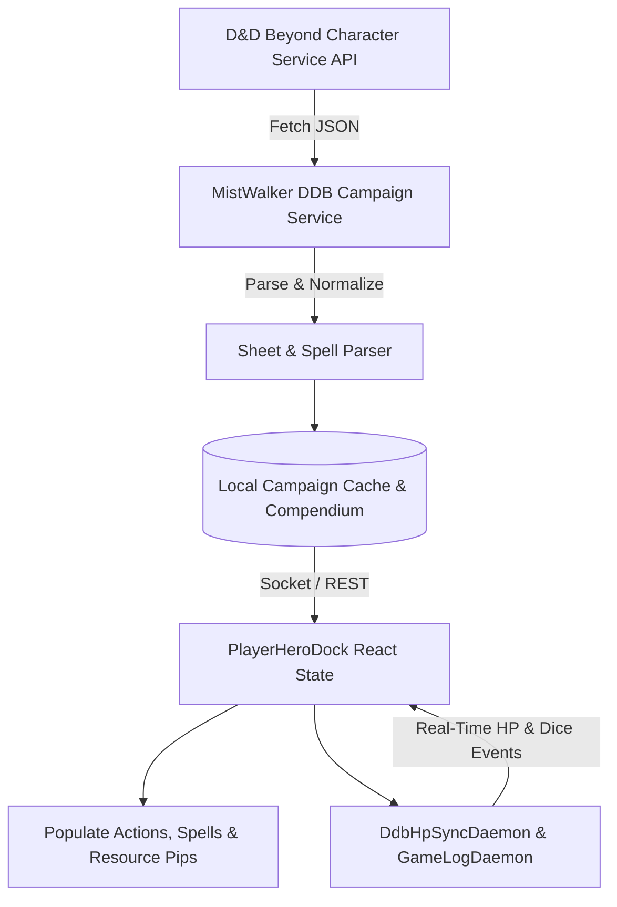
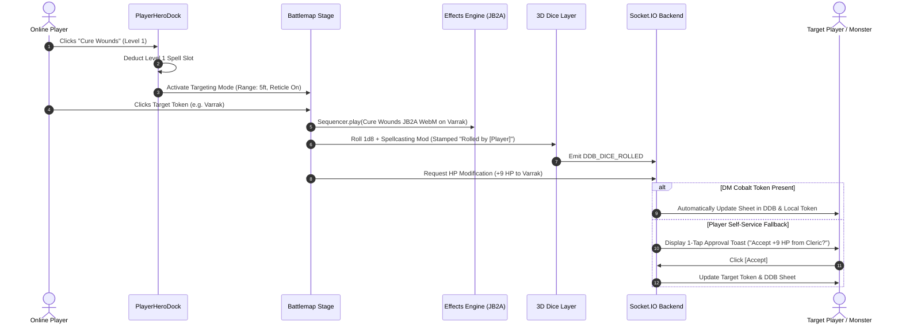

# MistWalker 4.0: BG3-Inspired Hero Bottom HUD Master Architecture & Plan

## 1. Executive Summary & Vision

The **Hero Bottom HUD** for MistWalker transforms the `PlayerView` into an immersive, tactical Baldur's Gate 3-style interface. Designed specifically for **remote / online players** while preserving clean passthrough for **in-person digital TV tables**, this HUD empowers each player to:
- Directly control their character's actions, bonus actions, spells, and items.
- Cast spells and attack targets on the battlemap with real-time **JB2A visual effects** and **3D dice rolls**.
- Seamlessly synchronize with **D&D Beyond**, automatically populating abilities, prepared spells, and spell slots.
- Perform targeted interactions (e.g. healing an ally or damaging a monster) while respecting D&D Beyond's permission boundaries (via DM Cobalt token auto-sync or 1-tap player approval prompts).

```
+-------------------------------------------------------------------------------------------------------------------+
|  [ LEFT WING: HERO ORB ]   |           [ CENTER: BG3 HOTBAR GRID ]            |    [ RIGHT WING: UTILITY ]       |
|  - Radial HP / Temp HP     |  [Action] [Bonus] [Spells] [Items] [Passives]    |  - Turn Order & Initiative       |
|  - Character Portrait      |  ---------------------------------------------   |  - Short / Long Rest             |
|  - Armor Class & Speed     |  [Slot 1] [Slot 2] [Slot 3] [Slot 4] [Slot 5]    |  - D&D Beyond Sheet Link         |
|  - Passive Perception / DC |  [Fireball] [Cure Wounds] [Misty Step] ...       |  - Targeting Status / Cancel     |
+-------------------------------------------------------------------------------------------------------------------+
```

---

## 2. HUD Layout & Component Anatomy

Inspired by the [BragginRites/bg3-hud-dnd5e](https://github.com/BragginRites/bg3-hud-dnd5e) layout, the HUD is organized into three balanced modules docked along the bottom of the viewport:

### A. The Left Wing: Character Orb & Vitals
1. **Orb Portrait & Radial Health**:
   - High-resolution circular token portrait.
   - Dual-ring radial gauge:
     - **Red/Green Outer Ring**: Current HP / Max HP with smooth SVG transition.
     - **Cyan/White Overlay Ring**: Temporary HP (`tempHp`).
   - Death Save pips (3 green success pips, 3 red failure pips) if current HP drops to 0.
2. **Tactical Badges**:
   - **Armor Class (AC)**: Shield badge overlaid on the bottom right of the orb.
   - **Movement Speed**: Remaining movement indicator (e.g. `30/30 ft.`) that dims as the token moves during their turn.
   - **Passives Pill**: Compact badges showing Passive Perception, Passive Insight, and Spell Save DC.

### B. The Center: The Hotbar & Filter Trays
A 2-tier slotted grid with stone-and-dark-iron styling (`bg-zinc-950/95`, `border-amber-600/30` with subtle golden highlights).

1. **Top Category Filter Tabs**:
   - **All**: Shows favorite and primary combat options.
   - **Actions (Green Pip)**: Weapon attacks, Unarmed strikes, Dash, Disengage, Dodge, Hide, Help.
   - **Bonus Actions (Orange Pip)**: Class features (Rage, Second Wind, Bardic Inspiration, Cunning Action, Misty Step, Healing Word).
   - **Spells (Blue Star Pip)**: Grouped dynamically by Spell Level (Cantrip, 1st, 2nd, 3rd, etc.).
   - **Items & Consumables (Purple Pip)**: Potions, scrolls, and usable inventory items.
   - **Passives & Toggles (Gray Pip)**: Great Weapon Master, Sharpshooter, Non-lethal damage toggles.
2. **Resource Tracker Header**:
   - **Action Pip**: Green diamond (Filled = Available, Gray = Expended).
   - **Bonus Action Pip**: Orange triangle.
   - **Reaction Pip**: Purple square.
   - **Spell Slot Matrix**: Roman numeral chips (`I`, `II`, `III`, `IV`, `V`...) with circular fill dots showing remaining slots (e.g. `● ● ○` for 2/3 level 1 slots).
3. **Action Hotbar Slots (2x10 Grid)**:
   - Icon-rich square tiles with cooldown indicators and resource cost badges.
   - Rich hover tooltips with spell level, casting time, range, components, and damage formula.
   - Visual range indicators on the battlemap when hovering an action slot.

### C. The Right Wing: Turn & Utilities
1. **Turn Flow Controls**:
   - **End Turn Button**: Prominent golden button pulsing when it is the player's active turn.
   - **Initiative Badge**: Shows current turn position and round counter.
2. **Rest & Status Actions**:
   - **Short Rest** (Hit Dice roller modal) & **Long Rest** (Full recovery trigger).
   - **Active Conditions Tray**: Expandable badges for active buffs/debuffs (Blessed, Poisoned, Concentrating, Invisible).
3. **DDB Popout**:
   - Quick one-click external sheet link (`https://www.dndbeyond.com/characters/{id}`).

---

## 3. Data Ingestion: How D&D Beyond Populates the HUD

To guarantee accurate stats, attacks, and spells without tedious manual entry, the HUD leverages a multi-stage data ingestion pipeline.



### Step 1: Deep Sheet Ingestion (`server/ddbCampaignService.ts`)
The character payload from `https://character-service.dndbeyond.com/character/v5/character/{id}` provides complete raw data:
- `c.actions`: Class features with attack rolls and damages.
- `c.classSpells` and `c.spells`: All known and prepared spells, mapped to spell levels.
- `c.spellSlots` & `c.pactMagicSlots`: Maximum and currently expended slots.
- `c.inventory`: Weapons, magical items, and consumables (potions).
- `c.classes`: Class features and archetype resources (Ki points, Sorcery points, Rages, Bardic Inspiration).

### Step 2: Normalization & Category Mapping
A server-side helper `normalizeDdbCharacterToHud(ddbData)` transforms the raw JSON into the HUD's unified `HudAction` schema:

```typescript
export interface HudAction {
  id: string;
  name: string;
  type: 'action' | 'bonus_action' | 'reaction' | 'item' | 'passive';
  category: 'attack' | 'spell' | 'feature' | 'item';
  level?: number;             // 0 = cantrip, 1-9
  rangeFt?: number;
  hitBonus?: string | number; // e.g. "+7"
  damageFormula?: string;    // e.g. "1d8 + 4"
  damageType?: string;       // e.g. "slashing", "fire", "radiant"
  description: string;
  jb2aAssetId?: string;      // Auto-matched via findJb2aAsset()
  cost: {
    actionType: 'action' | 'bonus' | 'reaction' | 'none';
    spellSlot?: number;
    resourceName?: string;   // e.g. "Rage", "Ki"
  };
}
```

### Step 3: JB2A Asset Auto-Linking
When actions and spells are normalized, they are automatically cross-referenced with `JB2A_REGISTRY` using `findJb2aAsset(action.name)`:
- *Fire Bolt* $\rightarrow$ `fire_bolt` (projectile + impact)
- *Cure Wounds* $\rightarrow$ `cure_wounds` or `template_circle_radiant`
- *Longsword Attack* $\rightarrow$ `melee_slash_physical`
- *Eldritch Blast* $\rightarrow$ `eldritch_blast` (beam + burst)

If no exact asset exists, the system gracefully falls back to the **Template Fallback Matrix** (`src/effects/db/templateFallbackMatrix.ts`) based on spell school and paradigm.

---

## 4. Player Interaction & Targeting Pipeline

When an online player takes an action via the HUD, the interaction flows through an intuitive targeting loop:



### Targeting Safety & Conflict Prevention
1. **Disabling Token Claiming During Targeting**:
   - In `PlayerView.tsx`, clicking an unowned token ordinarily triggers `onClaimToken(token.id)`.
   - In Targeting Mode (`isTargeting === true`), the token click event is intercepted exclusively as `onSelectTarget(token.id)`. The player cannot accidentally seize the other player's character.
2. **Range Indicator**:
   - When hovering or selecting a spell/weapon, a dynamic translucent circle displays the action's reach (e.g., 5 ft for Melee, 30 ft for Healing Word, 120 ft for Fire Bolt) centered on the player's token.
   - Out-of-range targets are visually dimmed, and clicking them displays a non-blocking toast: *"Target is out of range (requires 30 ft.)"*.

---

## 5. Station Isolation & Multi-Player Management

MistWalker supports hybrid games where in-person players view a shared TV table while remote players join on laptops/tablets. The HUD strictly respects station identity:

1. **Station Modal & Role Determination**:
   - When launching `PlayerView`, users choose their station:
     - **Station A: In-Person TV Screen**: HUD hidden, full-screen battlemap, shared party vision, unconstrained token movement for the tabletop.
     - **Station B: Online Player View**: BG3 HUD active, individual dynamic lighting/FOV, token claiming restricted to their assigned character.
2. **Session Storage Persistence**:
   - Stored in `sessionStorage` (`mistwalker_station_type`, `mistwalker_claimed_character_id`).
   - Switching maps or reloading the page automatically restores the player's claim and HUD without resetting the session.
3. **Token Claim Locking**:
   - Remote players can only move and command their claimed token. Other tokens display an informational tooltip on hover and cannot be dragged.

---

## 6. Detailed Implementation Roadmap

### Phase 1: Ingestion & Backend Endpoints
- [ ] Add `normalizeDdbCharacterToHud` in `server/ddbCampaignService.ts` to parse spells, slots, actions, and items from the DDB character API.
- [ ] Add endpoint `GET /api/ddb/character/:id/hud-data` to provide instant structured JSON for the HUD.
- [ ] Add DM Cobalt token setting in the DM View settings panel, enabling automatic D&D Beyond mutations.
- [ ] Add Socket.IO mutation pipeline: `REQUEST_TOKEN_HEAL` / `REQUEST_TOKEN_DAMAGE` with approval routing.

### Phase 2: Station Modal & Player Identity Locking
- [ ] Create `src/components/PlayerStationModal.tsx` allowing players to pick "In-Person TV Table" or "Remote Player".
- [ ] Update `PlayerView.tsx` to persist claimed character in `sessionStorage`.
- [ ] Implement token permission enforcement (disallow dragging unowned tokens in Remote mode).

### Phase 3: The BG3 Hero Bottom HUD Component (`PlayerHeroDock.tsx`)
- [ ] Build Left Wing: Circular portrait, SVG radial HP/TempHP gauges, AC shield, Speed pill, Passive Perception.
- [ ] Build Center Hotbar: CSS grid with stone/iron beveled slots, filter tabs (Actions, Bonus Actions, Spells, Items, Passives), and Roman numeral spell slot pips.
- [ ] Build Right Wing: Turn indicator, rest buttons, conditions tray, and external DDB sheet popout.
- [ ] Connect hover tooltips displaying 5e stats, damage formulas, and ranges.

### Phase 4: Targeting, JB2A Animation & 3D Dice Execution
- [ ] Implement Targeting Reticle mode on Konva canvas: intercept token clicks, verify range, and prevent token claiming.
- [ ] Trigger JB2A WebM animations via `src/effects` (`EffectOverlay` and `Sequencer`).
- [ ] Fire 3D dice rolls via `DiceTableOverlay` stamped with `"Rolled by [Character Name]"`.
- [ ] Emit Socket.IO events for game logs and live sync across all connected clients.

### Phase 5: Verification & Mandatory Deployment
- [ ] Test hybrid multi-tab scenarios (DM View + TV Table + Remote Player View).
- [ ] Verify clean compilation (`npm run build`).
- [ ] Commit and push to GitHub `origin/main`.
- [ ] Trigger live deployment on Render (`node scripts/deploy.js` or `npm run deploy`).
- [ ] Verify HTTP 200 health on `https://mistwalker.onrender.com/`.

---

## 7. Open Questions & Alignment
1. **Action Customization**: Would you like players to be able to drag and rearrange action slots in the hotbar (like Baldur's Gate 3 custom decks), or should the grid automatically organize abilities by category?
2. **Spell Slot Recovery**: Should clicking a spell slot dot directly toggle it as expended/available for manual tracking, or strictly sync through D&D Beyond?
