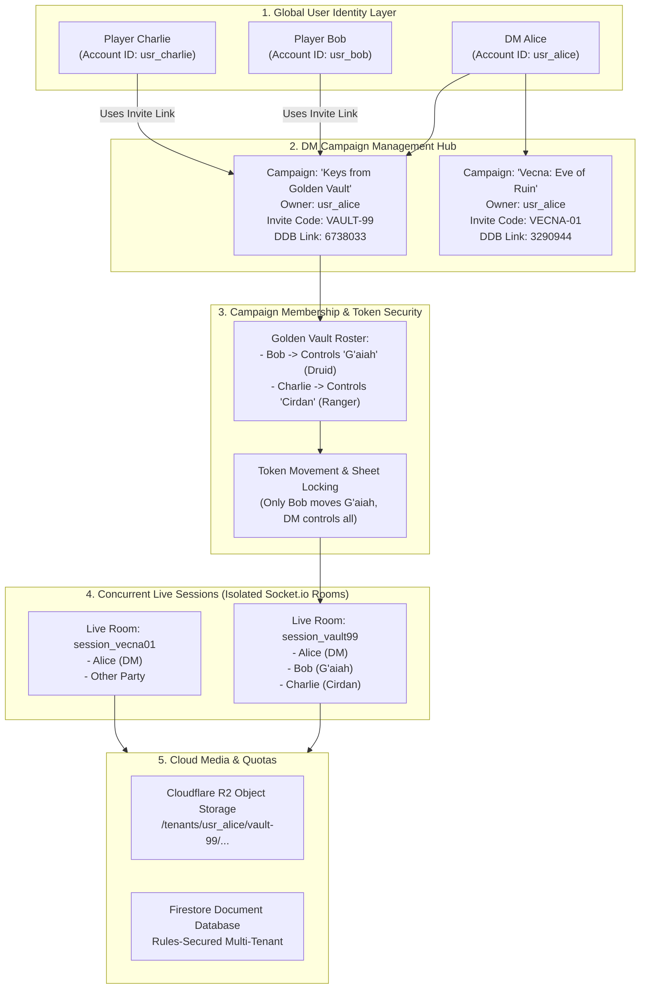
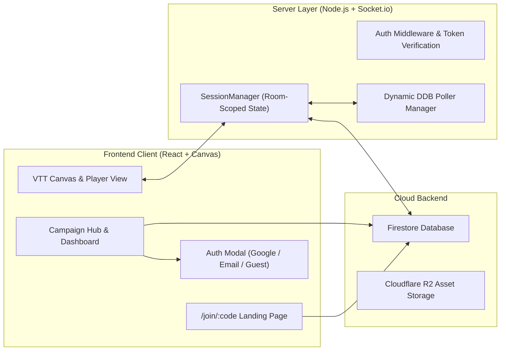

# MistWalker Commercial Multi-Tenant VTT: Master Architecture & Product Specification

## 1. Executive Vision: Building a Commercial Virtual Tabletop (The Roll20 / Foundry Model)

To transition **MistWalker** from a single-table private utility into a commercial SaaS platform competing with **Roll20**, **Foundry VTT**, and **Alchemy RPG**, the application must support:
1. **Independent User Accounts**: DMs and Players sign in independently (Google OAuth, Email/Password, Discord, or Guest). A single user can DM their own campaigns (*Keys from the Golden Vault*, *Vecna: Eve of Ruin*) while participating as a Player in friends' campaigns.
2. **DM Campaign Hierarchy**: Campaigns are independent persistent entities owned by a DM. Each campaign holds its own maps, chapters, fog-of-war states, D&D Beyond links, audio playlists, and character vault.
3. **Player-to-Campaign Linking & Hero Claiming (Roll20 "Controlled By" Pattern)**: Players join a specific DM's campaign via a permanent invite code/link (e.g., `mistwalker.vtt/join/VAULT-99`). In the campaign lobby, players claim (or DM assigns) their hero character. Once claimed, token movement and character sheet actions are strictly permission-locked to that player.
4. **Isolated Simultaneous Live Sessions**: Multiple DMs can host live games at the exact same moment on the platform. WebSockets, combat initiative, audio streaming, and map pings are strictly isolated to that specific campaign room.
5. **Commercial Monetization & Cloud Asset Delivery**: Free tier vs. Pro DM subscription tier, storage quotas (e.g. 200 MB Free vs. 10 GB Pro), and Cloudflare R2 object storage with zero egress fees for 4K battlemaps and WebM video.



---

## 2. Industry Benchmark: How Leading VTTs Solve This

| Architectural Feature | Roll20 | Foundry VTT | Alchemy RPG | **MistWalker Target Solution** |
| :--- | :--- | :--- | :--- | :--- |
| **User Identity** | Global email/social accounts. Single login for all games. | Local world user slots or Forge SaaS accounts. | Global Discord/Google/Email login. | **Firebase Auth** (Google OAuth + Email/Password + Anonymous Upgrade). |
| **Campaign Scoping** | Persistent "Game" container with dedicated invite hash. | "World" container hosted locally or per cloud container. | "Universe" / "Game" container. | **Firestore `/campaigns/{id}`** with `ownerUid`, `members` map, and 6-char `inviteCode`. |
| **Player Join Flow** | Invite link format: `roll20.net/join/12345/abc` | Direct IP/URL + player slot password. | Direct invite code format: `alchemy.rpg/join/xyz` | **Short Link & Code**: `mistwalker.vtt/join/VAULT-99` or entering code `VAULT-99` in Hub. |
| **Character Claiming** | "Controlled By" field in Character Sheet settings. | "Ownership" tab (None, Limited, Observer, Owner). | Seat assignment to character sheet. | **Hero Claim Engine**: DDB hero cards or custom tokens assigned to player UID; canvas locks drag-and-drop to token owner + DM. |
| **Simultaneous Games** | Horizontal WebSockets cluster with Redis PubSub. | 1 World process per license (or multi-tenant on Forge). | Distributed Elixir/Node cluster. | **Socket.io Rooms** (already implemented in Phase 1) + Redis Adapter for multi-instance scaling. |
| **Media Storage** | S3 bucket with per-tier quota (100MB free / 3GB Pro). | Local disk or AWS S3 integration. | Cloud asset storage. | **Cloudflare R2** (Zero egress fees for 4K video/battlemaps) with per-DM storage accounting. |
| **Monetization** | Free / Plus (\$5.99) / Pro (\$10.99/mo). | One-time \$50 license (self-hosted). | Free / Alchemy Unlimited (\$8/mo). | **Free Tier** (1 campaign, 200MB) vs. **Pro DM** (\$6.99/mo: unlimited campaigns, 10GB, live DDB sync, AI generator). |

---

## 3. Data Schema & Multi-Tenant Data Modeling

### 3.1 Campaign Document Schema (`/campaigns/{campaignId}`)

```typescript
export interface CampaignMember {
  uid: string;
  displayName: string;
  avatarUrl?: string;
  role: 'dm' | 'co_dm' | 'player' | 'spectator';
  claimedHeroId?: string;       // ID of the hero token/character this player controls
  joinedAt: number;
  lastActiveAt?: number;
}

export interface Campaign {
  campaignId: string;           // Unique ID (e.g. "camp_1730100000_abc")
  ownerUid: string;             // UID of the DM who created this campaign
  ownerDisplayName: string;
  campaignTitle: string;        // e.g. "Keys from the Golden Vault"
  description: string;
  bannerUrl?: string;
  inviteCode: string;           // 6-character human-friendly code (e.g. "VAULT9")
  createdAt: number;
  updatedAt?: number;
  
  // D&D Beyond Integration
  ddbCampaignId?: string;       // e.g. "6738033"
  ddbSyncEnabled?: boolean;

  // Membership & Access
  members: Record<string, CampaignMember>; // Keyed by Firebase Auth UID
  coDmUids: string[];

  // Game Content
  chapters: Chapter[];          // Chapters, Scenes, Maps, Walls, Fog
  characters: CampaignCharacter[]; // Roster of player heroes & NPC sheets
}
```

### 3.2 Token Ownership & Permission Schema

Every token on the battlemap inherits permission rules:
```typescript
export interface SceneToken {
  id: string;
  name: string;
  characterId?: string;         // Links to CampaignCharacter or DDB Hero ID
  controlledBy: string[];       // ['everyone'] or array of player UIDs. Empty = DM only.
  isPlayerToken: boolean;
  x: number;
  y: number;
  // ... stats, hp, ac, vision ...
}
```

**Permission Rules**:
- **Dungeon Master (`isDm === true`)**: Full control over all tokens, walls, fog reveals, doors, lighting, and monster stats.
- **Assigned Player**: Can only select, move, and ping tokens where `token.controlledBy.includes(user.uid)` or `token.characterId === member.claimedHeroId`.
- **Other Players**: Read-only view of ally tokens, no movement or stat edit capability.
- **Unrevealed Monsters**: Fully invisible to all players in fog of war.

---

## 4. End-to-End User Experience & Journeys

### Journey 1: The Dungeon Master (Creating & Hosting Campaigns)
1. DM visits MistWalker and clicks **"Sign In with Google"** (or Email).
2. The DM lands on the **MistWalker Campaign Hub**:
   - Sees their created campaigns: e.g. *Keys from the Golden Vault* and *Vecna: Eve of Ruin*.
   - Clicks **"+ New Campaign"**, types title, uploads a cover image, and optionally links their D&D Beyond Campaign ID (`6738033`).
3. The app generates a permanent 6-character invite code: `VAULT9`.
4. DM clicks **"Copy Invite Link"** (`mistwalker.onrender.com/join/VAULT9`) and sends it to their players on Discord or WhatsApp.
5. DM clicks **"Launch Game"**:
   - Boots up the live VTT room `session_camp_golden_vault`.
   - The DDB daemon worker activates for this campaign.

### Journey 2: The Player (Joining & Playing)
1. Player clicks the invite link: `mistwalker.onrender.com/join/VAULT9`.
2. A sleek join screen appears:
   - "You've been invited to join **Keys from the Golden Vault** hosted by **DM Scott**!"
   - Prompts player to sign in or enter their player name ("Sarah").
3. Upon entering:
   - Player is registered in `campaign.members[sarahUid]`.
   - Player sees the campaign character roster: "Select your Hero: [G'aiah (Druid 6)] [Thorin (Fighter 6)]".
   - Sarah clicks **"Claim G'aiah"**.
4. The live VTT loads in **Player View Mode**:
   - Sarah only sees what G'aiah can see through Fog of War and Dynamic Raytracing.
   - Sarah can move G'aiah's token across the battlemap.
   - The DM's screen instantly updates via WebSockets in real time.

---

## 5. Architectural Implementation Components



### Component Breakdown:
1. **`src/components/AuthModal.tsx`**:
   - Clean, professional login dialog supporting Google Sign-In, Email/Password login/registration, and "Continue as Guest".
2. **`src/components/CampaignHubModal.tsx`**:
   - Commercial dashboard showing all owned and joined campaigns, invite code generator, and one-click session launcher.
3. **`src/components/PlayerJoinLanding.tsx`**:
   - Dedicated landing page for `/join/:code` handling invite acceptance, account creation, and hero claiming.
4. **`src/lib/campaignInvite.ts`**:
   - Code generation (`nanoid` or collision-resistant alphabet `23456789ABCDEFGHJKLMNPQRSTUVWXYZ`), Firestore lookup, and membership linking.
5. **`server/sessionManager.ts` & `src/lib/sessionUrl.ts`**:
   - Real-time room routing ensuring campaigns are 100% isolated.

---

## 6. Commercial SaaS Roadmap & Phased Execution

- [x] **Phase 1: Real-Time Session Isolation**: Room-scoped WebSockets (`server/sessionManager.ts`, `sessionUrl.ts`, and room event emissions).
- [ ] **Phase 2: Persistent User Authentication & Profiles**: Google OAuth & Email authentication replacing anonymous-only auth; user profile state.
- [ ] **Phase 3: Campaign Ownership & Invite System**: Campaign data model with `ownerUid`, `members`, unique 6-character `inviteCode`, and the `/join/:code` player workflow.
- [ ] **Phase 4: Player Hero Claiming & Token Permission Guard**: Players can claim hero tokens; drag-and-drop token manipulation is permission-locked to token owner and DM.
- [ ] **Phase 5: Cloudflare R2 Media Storage & DM Quotas**: Direct pre-signed browser-to-bucket uploads with per-tier storage limits (200MB free / 10GB pro).
- [ ] **Phase 6: Stripe Monetization & Subscription Tiers**: Webhook listeners to activate Pro DM features.
