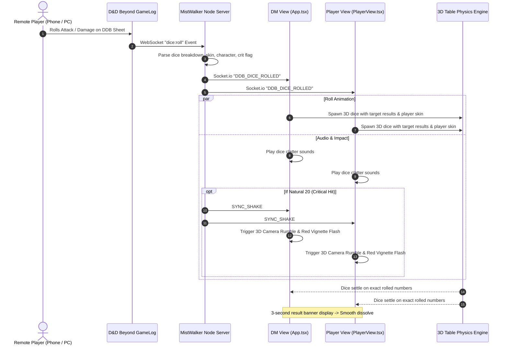
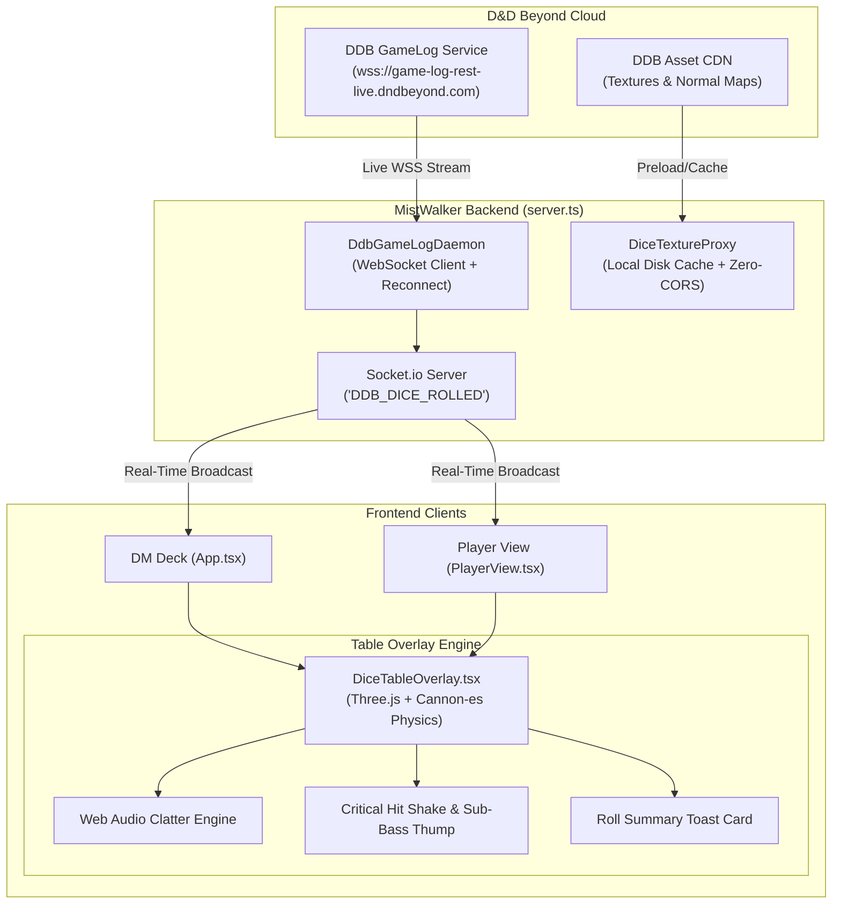

# Architectural & Implementation Plan: D&D Beyond Live Dice Stream & 3D Table Physics

## 1. Executive Summary

This plan outlines the architecture for streaming dice rolls made by remote players on **D&D Beyond** directly into **MistWalker VTT**, rendering **3D physical dice rolling across the battlemap**, supporting custom **dice skins**, and synchronizing roll results with the **Player View (`?view=player`)**, **DM View**, and **Combat Tracker**.



---

## 2. Component Architecture



---

## 3. Subsystem Breakdown

### Subsystem A: D&D Beyond GameLog Ingestion Daemon
Located in `server/ddbGameLogDaemon.ts` alongside existing `ddbCampaignService.ts`.

1. **Authentication & Connection**:
   - Uses the campaign's active `CobaltSession` token to obtain a temporary GameLog JWT from:
     `https://auth-service.dndbeyond.com/v1/cobalt-token` or `https://game-log-rest-live.dndbeyond.com/v1`.
   - Opens an authenticated WebSocket connection subscribed to `campaign:{campaignId}`.
2. **Payload Parsing**:
   - Extracts:
     - `characterId`: Matches directly to map tokens / compendium characters.
     - `characterName` & `avatarUrl`: For the banner portrait.
     - `action`: e.g., *"Glaive Attack"*, *"Sneak Attack Damage"*, *"Wisdom Saving Throw"*.
     - `rollType`: `"attack"`, `"damage"`, `"check"`, `"save"`.
     - `dice`: Array of `{ type: 'd20' | 'd6' | ..., result: number, count: number }`.
     - `constant`: Static modifier (e.g., `+7`).
     - `total`: Final roll sum.
     - `isCritical`: Boolean flag for Nat 20.
     - `theme`: Player's equipped dice skin ID (e.g., `"frost"`, `"magma"`, `"obsidian-gold"`).
3. **Resilience & Fault Tolerance**:
   - **Heartbeat Ping**: 30-second ping/pong to prevent ISP timeout.
   - **Exponential Backoff**: Automatic reconnection (`1s -> 2s -> 5s -> 15s`) if internet or DDB briefly disconnects.
   - **Fallback REST Polling**: If WebSockets fail due to network firewall, falls back to polling the recent log endpoint every 2 seconds.

---

### Subsystem B: 3D Physics Dice Engine on the Table
A specialized component: `src/components/DiceTableOverlay.tsx`.

1. **Layering & Placement**:
   - Placed as a transparent layer directly above the battlemap and under the UI HUD (`z-[80] pointer-events-none`).
   - Renders with alpha channel enabled, giving the illusion that dice physically tumble across the battlemap, bouncing off the surface.
2. **Physics & Predetermined Trajectory**:
   - Built with **Three.js** and **Cannon-es** physics.
   - Supports any combination of dice simultaneously (e.g., `1d20 + 2d6 + 1d4`).
   - **Target Landing Solver**: When a predetermined result arrives (e.g., DDB rolled an `18` on a d20), the engine orients the 3D die geometry so the face with `18` aligns with the final resting angle while the physics simulation handles realistic tumbling, linear velocity, angular impulse, and screen-boundary bounces.
3. **Audio Synthesis**:
   - Uses Web Audio API for multi-channel dice collision sound effects.
   - Audio pitch and volume scale dynamically with the impact velocity of each die hitting the virtual table or another die.
4. **Dissolve & Read Lifecycle**:
   - **Roll Phase**: Dice roll and settle (~1.2 seconds).
   - **Hold Phase**: Camera/focus freezes on the resting dice for 2.5 seconds with glowing numeral highlights.
   - **Fade Phase**: Dice smoothly dissolve (opacity $1.0 \rightarrow 0$) over 600ms, returning the table to pristine clarity.

---

### Subsystem C: Dice Skin & PBR Material Pipeline
Located in `server/diceSkinService.ts` and `src/services/diceSkinManager.ts`.

1. **Local Proxy & Texture Caching (Zero-CORS, Zero-Lag)**:
   - To eliminate cross-origin blocking (CORS `tainted canvas`) and avoid internet latency, textures are stored/cached locally on the server in `public/assets/dice/skins/`.
2. **Skin Catalog Mapping**:
   | DDB Theme Key | Material Type | Visual Appearance |
   | :--- | :--- | :--- |
   | `default_black` | Polished Resin | High-gloss jet black with crisp white numerals |
   | `magma` / `hellfire` | Emissive Obsidian | Dark volcanic rock with glowing orange magma fissures |
   | `rime` / `frost` | Translucent Crystal | Frosted light cyan glass with specular ice glints |
   | `obsidian_gold` | Gilded Stone | Matte obsidian faces with gold-leaf beveled edges |
   | `arcane` / `nebula` | Deep Cosmic | Starfield swirl with glowing violet runes |
   | `classic_wood` | Carved Hardwood | Natural wood grain with engraved burnt runes |
3. **Preloading**:
   - When a session starts or characters are imported from D&D Beyond, active character skin textures are preloaded into WebGL memory.
   - When a roll happens, textures are already in GPU VRAM: **0ms hitch**.

---

### Subsystem D: Visual Presentation & VTT Synergy

```
+---------------------------------------------------------------------------------+
|  MISTWALKER BATTLEMAP (PLAYER VIEW & DM VIEW)                                   |
|                                                                                 |
|     [Token: Thorin]                    [Token: Goblin]                          |
|                                                                                 |
|                      /\                                                         |
|                     / 18 \   (3D Physical Dice tumbling across the map)         |
|                     \____/     + [d6: 5]  [d6: 6]                               |
|                                                                                 |
|                                                                                 |
|  +---------------------------------------------------------------------------+  |
|  | [Avatar] THORIN OAKENSHIELD  *  Warhammer Attack & Smite                 |  |
|  | Result: 1d20 (18) + 2d6 (11) + 4  =  33 (HIT!)                            |  |
|  +---------------------------------------------------------------------------+  |
+---------------------------------------------------------------------------------+
```

1. **Floating Roll Card**:
   - Displays character avatar, character name, roll type, formula, and final total in a glassmorphic banner at the bottom-center or top-center of the screen.
2. **Natural 20 Critical Hit Integration**:
   - If `isCritical: true` is received:
     - The die lands with a golden particle burst.
     - Triggers the existing `SYNC_SHAKE` event across all screens (3D camera rumble + red vignette flash + sub-bass audio thump).
3. **Combat Tracker Integration**:
   - If an initiative check is rolled on D&D Beyond, it can automatically populate or update that combatant's initiative in the Combat Tracker.

---

## 4. Edge Cases & Resilience Strategy

| Edge Case / Failure Mode | Protection Mechanism |
| :--- | :--- |
| **DDB WebSocket Drops / Network Flap** | Automatic reconnect daemon with exponential backoff (`1s -> 2s -> 5s -> 15s`) + heartbeat ping. |
| **Player Rolls Offline / DDB Outage** | Local dice roller in MistWalker shares the exact same 3D physics engine and skin library. |
| **Low-End Hardware / Mobile Device** | Performance settings toggle: `3D Physical Dice` (high) vs `2D Cinematic Banner Only` (low). Automatically throttles to 30 FPS or disables 3D physics if WebGL reports low FPS. |
| **CORS WebGL Taint** | All textures are proxied or locally bundled by the server—no direct cross-origin fetches in WebGL. |
| **Player Toggles Off Dice** | Toggle in Player View settings: `Show 3D Dice on Table (On/Off)`. |

---

## 5. Phased Implementation Roadmap

### Phase 1: 3D Physics Dice Engine (`DiceTableOverlay`)
- [ ] Install `@3d-dice/dice-box` or Three.js + Cannon-es physics bundle.
- [ ] Implement `DiceTableOverlay.tsx` mounted above Konva battlemap.
- [ ] Implement Web Audio collision sound effects.
- [ ] Wire local dice tray in `App.tsx` and `PlayerView.tsx` to roll 3D dice with auto-dissolve.

### Phase 2: D&D Beyond GameLog WebSocket Daemon
- [ ] Create `server/ddbGameLogDaemon.ts` connecting to `game-log-rest-live.dndbeyond.com`.
- [ ] Parse roll events (dice types, modifiers, totals, character IDs, crit flags, skin IDs).
- [ ] Emit `DDB_DICE_ROLLED` over Socket.io to DM and Player views.

### Phase 3: Dice Skins & Texture Management
- [ ] Build `server/diceSkinService.ts` to manage skin mappings and local texture caching.
- [ ] Implement PBR materials (Hellfire, Frost, Obsidian Gold, Arcane, Resin).
- [ ] Preload textures based on active campaign characters.

### Phase 4: VTT Synergies & Polish
- [ ] Create glassmorphic `RollSummaryToast.tsx` card displaying character avatar & roll breakdown.
- [ ] Connect Natural 20 rolls to the synchronized `SYNC_SHAKE` camera rumble and sub-bass thump.
- [ ] Add user toggle in Player View to enable/disable 3D dice on the screen.

### Phase 5: Verification & Deployment
- [ ] Verify clean build (`npm run build`).
- [ ] Test multi-dice combinations (e.g. `1d20 + 4d6`) and multiple consecutive rolls.
- [ ] Git commit, push to GitHub, and trigger live cloud deployment to Render.
