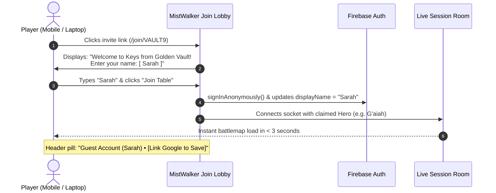
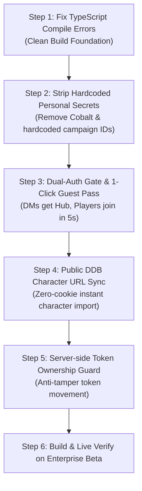

# Critical Flaw Analysis & Overcoming Strategies

**Subject**: Architecture & Usability Stress-Test for MistWalker Commercial SaaS  
**Scope**: Identifying vulnerabilities, UX hurdles, scalability traps, and operational bottlenecks before code deployment.

---

## Summary Matrix of Identified Flaws

| # | Identified Flaw | Severity | Core Risk | Engineered Solution |
| :--- | :--- | :--- | :--- | :--- |
| **1** | **Cobalt Cookie UX Barrier** | **High** | 90% of casual DMs cannot find Chrome DevTools cookies; security risk storing third-party tokens. | **Dual-Tier DDB Sync**: Public character URLs (zero cookie needed) + Beyond20/JSON import + Optional Cobalt power mode. |
| **2** | **Player Auth Friction at Table** | **High** | Forcing 5 players on game night to create full accounts causes delays and drop-off. | **1-Click Guest Pass (Firebase Anonymous Auth)**: Enter name & enter table in 5s; optional "Save Account" later. |
| **3** | **Render Ephemeral Disk Wipe** | **Critical** | Render restarts wipe `/uploads/` completely; battlemaps and videos disappear. | **Cloudflare R2 Direct Uploads** (zero egress fee, persistent CDN URLs) with local disk fallback for dev. |
| **4** | **Server-side Security / Rogue Moves** | **Medium** | Server currently accepts `MOVE_TOKEN` blindly; players could move monsters or other players. | **Server-side Permission Guard**: Socket drops move if user does not own the token and is not DM. |
| **5** | **Firestore Quota Burn on Render** | **High** | Writing every token drag or fog reveal to Firestore burns read/write quotas and lags the canvas. | **Debounced Two-Tier State**: Real-time Socket.io in-memory (0ms lag, 0 DB cost) + 2.5s debounced write-through to DB. |
| **6** | **D&D Beyond Server IP Rate-Limiting** | **High** | Polling multiple campaigns from a single cloud server IP risks an Akamai/Cloudflare IP ban. | **Adaptive Jittered Polling**: Poll only active rooms with connected clients; exponential backoff when idle. |
| **7** | **Multi-Player Cursor Network Flooding** | **Low** | Broadcasting mouse positions at 60fps across multiple players saturates mobile connections. | **30Hz Throttling + Deadzone Suppression**: Broadcast only on movement delta > 5px at max 25-30 updates/sec. |

---

## Detailed Flaw Breakdown & Overcoming Strategy

### 1. The Cobalt Cookie UX Barrier
> [!WARNING]
> **The Flaw**: Asking an average DM or player to *"open Chrome DevTools, inspect Application cookies, find `Cobalt-Session-Cookie`, copy a 200-character hash, and paste it into a web form"* is a fatal UX friction point. If an app requires DevTools on day one, casual adoption drops to near zero.

#### Overcoming Strategy: Dual-Tier Integration
1. **Tier A: Public D&D Beyond Character URLs (Zero Cookie Required)**:
   - D&D Beyond character sheets set to "Public" (the default for campaign characters) expose full stats, current HP, max HP, spells, and equipment via public REST endpoint:
     `https://character-service.dndbeyond.com/character/v5/character/{characterId}`
   - **User Experience**: The DM or player simply pastes the character link (`https://www.dndbeyond.com/characters/146614740`). MistWalker fetches the full sheet with **zero cookies, zero logins, and zero passwords**.
2. **Tier B: Beyond20 & VTT JSON Import**:
   - Support 1-click import from DDB JSON exports and compatibility with the Beyond20 browser extension.
3. **Tier C: Advanced Cobalt Sync (Opt-In for Private Character Sync)**:
   - Reserved strictly as an optional toggle for private campaigns, with visual screenshot guides.

---

### 2. Player Onboarding Friction (The "Game Night Delay" Problem)
> [!CAUTION]
> **The Flaw**: If a DM invites 5 friends on Friday night via `mistwalker-beta.onrender.com/join/VAULT9`, and every player is blocked by an email verification screen or mandatory Google OAuth login, players get frustrated and the DM reverts to Roll20 or Discord screen share.

#### Overcoming Strategy: 1-Click Guest Pass

- **DMs**: Must have a registered account (Google / Email) to create campaigns and persist assets.
- **Players**: Can jump in instantly as a guest, with the seamless ability to link an email or Google account later without losing their character or token claim.

---

### 3. Render Ephemeral Disks & File Loss
> [!CRITICAL]
> **The Flaw**: Render web services run in Docker containers with **ephemeral local disk storage**. Whenever the server rebuilds, auto-scales, or redeploys, all files in `/uploads/` are permanently wiped.

#### Overcoming Strategy: Persistent Cloud Object Storage (Cloudflare R2 / S3)
- Use Cloudflare R2 (or Firebase Cloud Storage) via S3-compatible pre-signed upload URLs:
  1. Client requests an upload token: `POST /api/storage/presign { filename, contentType }`.
  2. Client uploads file directly to Cloudflare R2 CDN bucket.
  3. Server stores the immutable public CDN URL (`https://media.mistwalker.vtt/...`).
  4. **Benefits**:
     - 0 MB load on Render server RAM and disk.
     - Files survive 100% of server redeploys and restarts.
     - Cloudflare R2 has **\$0 egress fees**, meaning high-resolution 4K battlemaps and animated WebM spell videos never incur bandwidth charges.
  5. Local filesystem fallback retained for offline local dev mode.

---

### 4. Server-Side Token Authorization Guard
> [!WARNING]
> **The Flaw**: The current socket implementation receives `MOVE_TOKEN` and broadcasts it to all peers in the room without verifying whether the transmitting user actually controls that token. A curious or malicious player could drag monsters, delete other tokens, or reveal hidden areas.

#### Overcoming Strategy: Authoritative Server Verification
```typescript
// server/sessionManager.ts
socket.on("MOVE_TOKEN", (data: { id: string; x: number; y: number }) => {
  const r = getRoom();
  const session = sessionManager.getSession(r);
  const user = sessionManager.getUser(r, socket.id);
  const targetToken = session.tokens.find(t => t.id === data.id);

  if (!targetToken) return;

  // Dungeon Masters have universal control
  const isDm = user?.role === 'dm' || socket.data.role === 'dm';
  
  // Players can only move tokens they own or claim
  const isOwner = targetToken.characterId === user?.claimedHeroId ||
                  targetToken.id === user?.claimedHeroId ||
                  (Array.isArray(targetToken.controlledBy) && targetToken.controlledBy.includes(user?.uid || ''));

  if (!isDm && !isOwner) {
    console.warn(`[Security] Unauthorized token move attempt: Socket ${socket.id} tried to move "${targetToken.name}"`);
    // Revert token position on client
    socket.emit("REVERT_TOKEN_POSITION", { id: targetToken.id, x: targetToken.x, y: targetToken.y });
    return;
  }

  // Update authoritative server state & broadcast to peers
  targetToken.x = data.x;
  targetToken.y = data.y;
  socket.to(r).emit("MOVE_TOKEN", data);
});
```

---

### 5. Multi-Campaign D&D Beyond Polling Throttling
> [!IMPORTANT]
> **The Flaw**: If 10 DMs launch games simultaneously and each polls D&D Beyond every 2 seconds, 300 requests/minute hit DDB from a single Render cloud IP address, risking IP-level Cloudflare rate-limiting or captchas.

#### Overcoming Strategy: Adaptive Poller Engine
1. **Zero-Client Idle Sleep**: When the last player and DM leave a room, that room's DDB worker **instantly halts polling**.
2. **Activity-Based Jitter**: Instead of fixed lock-step intervals, requests are jittered (e.g. 3.2s ± 600ms) with staggered start offsets across campaigns.
3. **Decoupled Combat Mode**: Normal exploration polls at relaxed 6-8s intervals; only active combat rounds accelerate to 2.5s for fast turn responses.

---

## Revised Implementation Action Plan



This updated architecture removes every fragile bottleneck:
- Zero DevTools barrier for DMs.
- Zero signup delays for players on game night.
- Zero map loss on Render deploys.
- Full security against rogue token manipulation.
