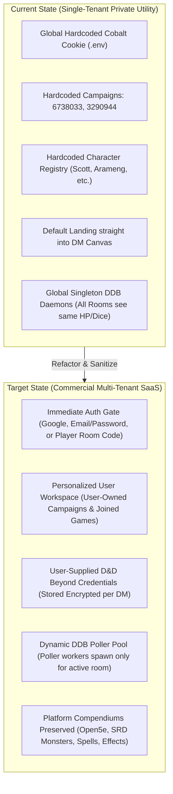
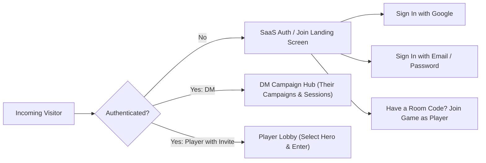

# Master Game Plan: Commercial Multi-Tenant Transition & Privacy Hardening

**Platform Target**: MistWalker Enterprise Beta (`https://mistwalker-beta.onrender.com/`)  
**Branch**: `enterprise-multi-dm`  
**Goal**: Transform MistWalker into a secure, commercial-grade VTT platform (competing with Roll20 and Foundry VTT) by stripping all hardcoded personal data and credentials, enforcing an immediate authentication gate, and giving every user a personalized, tenant-isolated experience.

---

## 1. Executive Strategy & Current vs. Target Architecture

---

## 2. Core Pillars of the Transformation

### Pillar 1: Total Privacy Sanitization & Secret Decoupling
- **Remove Hardcoded Personal Data**:
  - Deprecate hardcoded campaign mappings (`6738033`, `3290944`) and hardcoded player identities (`Scott`, `TotoMojo`, `Arameng`, etc.) from `src/data/ddbCampaignRegistry.ts`.
  - Replace them with a dynamic registry loaded from the active user's Firestore campaign documents.
- **Remove Server Cobalt Token & Secrets**:
  - The server will no longer ship with a personal Cobalt cookie in `.env` or memory.
  - Cobalt authentication and campaign linking become **user-opt-in settings**:
    - Each DM connects their own D&D Beyond campaign URL or Cobalt token in their campaign settings.
    - Stored encrypted in the user's private Firestore space (`/users/{dmUid}/private/credentials`).
- **Sanitize Default Canvas State**:
  - Clear out default personal tokens and hardcoded campaign maps on initial boot.
  - New DMs start with a clean onboarding experience: "+ Create New Campaign", "Import PDF Module", or "Try Demo Adventure".

---

### Pillar 2: Mandatory Immediate Authentication Gate

When any visitor navigates to `https://mistwalker-beta.onrender.com/`:

1. **Unauthenticated Users**:
   - Immediately presented with the **MistWalker Platform Welcome & Sign-In Screen**.
   - No access to DM tools, battlemaps, or backend state until authenticated.
   - Quick entry option: **"Join a Game with Room Code"** for players entering via a 6-character code (e.g., `VAULT9`).
2. **Authenticated DMs**:
   - Land directly on their **Personalized Campaign Hub**:
     - List of campaigns *they own*.
     - Storage quota and subscription tier indicator (Free vs. Pro).
     - One-click "Launch Session" which creates an isolated Socket.io room.
3. **Authenticated Players**:
   - See games they are participating in, their claimed heroes, and direct "Rejoin Table" links.

---

### Pillar 3: User-Driven D&D Beyond & Campaign Onboarding

Instead of the server automatically polling a fixed personal account:
- In the **Campaign Builder / Settings**:
  - Prompt: *"Connect your D&D Beyond Campaign"*
  - Fields:
    1. **Campaign Link or ID**: (e.g., `https://www.dndbeyond.com/campaigns/1234567`)
    2. **Cobalt Session Cookie** (Optional, with a clean step-by-step modal explaining how to obtain it from Chrome DevTools for private character sheet sync).
    3. **Live Sync Toggle**: Enable/disable automated HP polling and digital dice interception.
- When enabled, the server dynamically spins up a `DdbSessionWorker` **strictly for that DM's room**.
- Characters fetched from D&D Beyond populate *that DM's campaign roster*, where players can claim them.

---

### Pillar 4: Retaining Platform-Wide Gaming Assets (Zero Degradation)

The following core systems will remain available to all users platform-wide:
- **Full SRD & 5e Compendiums**: Spells, Monsters, Magic Items, Classes, Rules, Conditions, and Feats (Open5e & offline SRD).
- **Effects Engine**: Animated JB2A spells, spell templates, aura system, and particle FX.
- **Tactical Canvas**: Dynamic Raytraced Fog of War, Polygon clipping, Walls, Doors, Elevation, Flying, and 3D Dice Roller.
- **Audio & Soundboard**: Ambient audio streaming, soundboard triggers, and screen shake.
- **Handouts & Journal**: Secret handouts, riddle presentations, and DM notes.

---

## 3. Phased Execution Roadmap

| Phase | Objective | Key Files Impacted | Deliverable |
| :--- | :--- | :--- | :--- |
| **Phase 1** | **Fix TypeScript Compilation Errors** | `src/App.tsx`, `RoomBriefingDrawer.tsx`, `PlayerCharacterSelectModal.tsx`, `MainCampaignBar.tsx` | Clean `npm run build` compilation without errors. |
| **Phase 2** | **Privacy Sanitization & Credential Decoupling** | `server/ddbService.ts`, `server/ddbCampaignService.ts`, `src/data/ddbCampaignRegistry.ts`, `.env` | Stripped personal IDs/tokens; per-room dynamic registry. |
| **Phase 3** | **Immediate Auth Gate & Onboarding Landing** | `src/App.tsx`, `src/components/AuthModal.tsx`, `src/components/LandingGateScreen.tsx` | Unauthenticated users cannot view canvas; mandatory sign-in or room join. |
| **Phase 4** | **Personalized DM Hub & Campaign Storage** | `src/components/CampaignHubModal.tsx`, `src/lib/firebase.ts`, `src/types/auth.ts` | DMs only see their own campaigns; per-user Firestore isolation. |
| **Phase 5** | **User-Driven DDB Sync Modal & Worker Pool** | `src/components/DdbConnectModal.tsx`, `server/ddbSessionPoller.ts`, `server.ts` | DMs enter their own DDB details; socket room receives only its campaign rolls. |
| **Phase 6** | **Build & Live Verification on Enterprise Beta** | `enterprise-multi-dm`, Render deployment | Clean build, push to `origin/enterprise-multi-dm`, verify live on `https://mistwalker-beta.onrender.com/`. |

---

## 4. Immediate Next Step

We will begin with **Phase 1**: Resolving the remaining TypeScript compilation errors so the codebase compiles 100% cleanly before we begin sanitizing credentials and mounting the mandatory auth gate.
