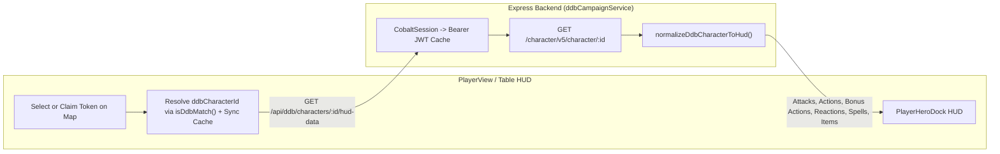

# Comprehensive Plan: D&D Beyond Live HUD Synchronization

## 1. Root Causes Identified in Live Audit

During our audit of the HUD pipeline and live tests against your party's D&D Beyond character sheets (`Varrak`, `Noctua`, `Aggie`, `Rowan`, `Aziza`, `Burmi`, `Stavros`, `Sylas`, `Etho`), we discovered **6 root causes** preventing the HUD from pulling real character data:

> [!CAUTION]
> **Root Cause #1: `fetchRawDdbCharacter` Fails with HTTP 403 (`Unauthorized`)**
> [`fetchRawDdbCharacter`](file:///g:/Scott/dnd/MistWalker/Mistwalker%203.0/server/ddbCampaignService.ts#L117-L148) calls `https://character-service.dndbeyond.com/character/v5/character/:id` with only the `CobaltSession` cookie and **no `Authorization: Bearer <jwt>` header**. D&D Beyond's `v5` character endpoint rejects requests without a Bearer JWT (`HTTP 403`), causing `/api/ddb/characters/:id/hud-data` to return `404` and forcing [`PlayerView.tsx`](file:///g:/Scott/dnd/MistWalker/Mistwalker%203.0/src/components/PlayerView.tsx#L1273-L1332) to fall back to generic placeholder actions (`"Main Weapon Attack"`, `"Fire Bolt"`, `"Cure Wounds"`).

2. **`c.actions` & `c.customActions` Are Completely Ignored**:
   - [`normalizeDdbCharacterToHud`](file:///g:/Scott/dnd/MistWalker/Mistwalker%203.0/server/ddbCampaignService.ts#L298-L456) only inspects `c.inventory` and `c.classSpells`/`c.spells`. It never parses `c.actions` (`race`, `class`, `feat`, `item`, `background`) or `c.customActions`.
   - As a result, all class/species/feat actions and bonus actions are missing:
     - **Varrak (`146614740`)**: *Rage (Enter)*, *Activate Large Form*, *Cloud's Jaunt*, *Cleave (Greataxe)*, *Topple*
     - **Noctua (`147334187`)**: *Cunning Action*, *Hunter's Mark*, *Dreadful Strike*, *Sneak Attack*
     - **Aggie (`158502126`)**: *Lightning Launcher (Int./Dex.)*, *Charge/Drain Magic Item*, *Flash of Genius*
     - **Rowan (`146533824`)**: *Bardic Inspiration*, *Mantle of Inspiration*, *Mantle of Majesty*, *Countercharm*
     - **Burmi (`57022089`)**: *Flurry of Blows*, *Patient Defense*, *Step of the Wind*, *Unarmed Strike*, *Wholeness of Body*
     - **Stavros (`27463658`)**: *Channel Divinity: Turn Undead*, *Channel Divinity: Preserve Life*, *Harness Divine Power*
     - **Sylas (`158983142`)**: *Crimson Rite*, *Pact of the Blade*, *Blood Curse of the Fallen Puppet*

3. **Spell Damage, Healing, Attack Bonus, and Save DCs Are Missing**:
   - [`normalizeDdbCharacterToHud`](file:///g:/Scott/dnd/MistWalker/Mistwalker%203.0/server/ddbCampaignService.ts#L350-L433) leaves `damageFormula` and `damageType` undefined on offensive spells instead of extracting `def.modifiers` (`type === 'damage'` / `type === 'bonus' && subType === 'hit-points'`), `def.requiresAttackRoll`, and `def.requiresSavingThrow`.
   - Bonus Action spells (*Healing Word*, *Misty Step*, *Hex*, *Hunter's Mark*) only appear under `Spells` and are missing from the `Bonus Actions` tab.

4. **Weapon Attack Math, Magic Bonuses & Duplicates**:
   - Unarmed strikes are omitted, ammunition (`Crossbow Bolts, +1`) is listed as a melee weapon attack, duplicate inventory weapons aren't deduplicated, and magic weapon bonuses (`Greataxe, +1`, `Battleaxe, +2`) aren't added to `hitBonus` or `damageFormula`.

5. **Token Selection $\rightarrow$ D&D Beyond ID Matching Fails on Short Token Names**:
   - [`PlayerView.tsx`](file:///g:/Scott/dnd/MistWalker/Mistwalker%203.0/src/components/PlayerView.tsx#L1339-L1354) uses strict equality (`c.name.toLowerCase() === claimedToken.name.toLowerCase()`), which fails when a map token is named `"Varrak"` or `"Aggie"` while the character record is `"Varrak \"Onikuma\" of Sky Veil Clan"` or `"Aggapanthus (Aggie)"`.

6. **JB2A Animation IDs Mismatch**:
   - [`matchJb2aAssetId`](file:///g:/Scott/dnd/MistWalker/Mistwalker%203.0/server/ddbCampaignService.ts#L196-L234) outputs IDs like `attack_sword_slash` and `attack_greataxe_cleave`, whereas [`JB2A_REGISTRY`](file:///g:/Scott/dnd/MistWalker/Mistwalker%203.0/src/effects/db/jb2aRegistry.ts#L14-L162) expects `attack_slash`, `attack_greatsword`, `attack_hammer`, `attack_bow`, `attack_crossbow`, `attack_dagger`, and `attack_unarmed`.

---

## 2. Architecture & Data Flow

---

## 3. Implementation Plan

### Phase 1: Fix D&D Beyond Bearer JWT Authentication
**Files**: [`server/ddbCampaignService.ts`](file:///g:/Scott/dnd/MistWalker/Mistwalker%203.0/server/ddbCampaignService.ts), [`server/ddbService.ts`](file:///g:/Scott/dnd/MistWalker/Mistwalker%203.0/server/ddbService.ts)
- Add a cached `getDdbBearerToken()` helper that exchanges `DND_BEYOND_COBALT_SESSION` (or `DND_BEYOND_DM_COBALT_SESSION`) against `https://auth-service.dndbeyond.com/v1/cobalt-token` (caching the token for 4 minutes, matching [`DdbGameLogDaemon.getBearerToken`](file:///g:/Scott/dnd/MistWalker/Mistwalker%203.0/server/ddbGameLogDaemon.ts#L103-L143)).
- Attach `'Authorization': 'Bearer ' + token` in [`fetchRawDdbCharacter`](file:///g:/Scott/dnd/MistWalker/Mistwalker%203.0/server/ddbCampaignService.ts#L117-L148) and [`fetchDdbCharacterData`](file:///g:/Scott/dnd/MistWalker/Mistwalker%203.0/server/ddbService.ts#L85-L120), with automatic retry if a token expires.
- Add a short in-memory cache (15s TTL + `forceRefresh` query param) so switching tokens is instantaneous while supporting 1-click live refresh from D&D Beyond.

### Phase 2: Complete D&D Beyond Action, Attack, Bonus Action & Spell Extractor
**Files**: [`server/ddbCampaignService.ts`](file:///g:/Scott/dnd/MistWalker/Mistwalker%203.0/server/ddbCampaignService.ts), [`src/types/hud.ts`](file:///g:/Scott/dnd/MistWalker/Mistwalker%203.0/src/types/hud.ts)
- **Extend [`HudActionItem`](file:///g:/Scott/dnd/MistWalker/Mistwalker%203.0/src/types/hud.ts#L9-L26) & [`PlayerHudCharacterData`](file:///g:/Scott/dnd/MistWalker/Mistwalker%203.0/src/types/hud.ts#L35-L60)**:
  - Add optional metadata fields to [`HudActionItem`](file:///g:/Scott/dnd/MistWalker/Mistwalker%203.0/src/types/hud.ts#L9-L26): `subCategory` (`'weapon' | 'unarmed' | 'class' | 'race' | 'feat' | 'spell' | 'item'`), `activationType` (`'action' | 'bonus' | 'reaction' | 'special'`), `saveDc?: number`, `saveAbility?: string`, `uses?: { current: number; max: number }`, `isEquipped?: boolean`, and `sourceLabel?: string`.
  - Add `reactions: HudActionItem[]` and `attacks: HudActionItem[]` (while keeping `actions` populated for backwards compatibility).
- **Weapon Attacks (`c.inventory` + Class Weapon Actions)**:
  - Filter out ammunition (`subType === 'Ammunition'`) and unequipped duplicate weapons (prioritize equipped weapons first, then unique unequipped weapons).
  - Detect magic item bonuses (`+1`, `+2`, `+3` from `def.grantedModifiers` or item name) and Finesse/Ranged/Pact/Artificer Int scaling.
  - Automatically generate each character's **Unarmed Strike** (accounting for Monk Martial Arts dice on Burmi).
- **Class, Species, Feat & Custom Actions (`c.actions` & `c.customActions`)**:
  - Iterate through `c.actions.race`, `c.actions.class`, `c.actions.feat`, `c.actions.item`, `c.actions.background`, and `c.customActions`.
  - Route by `activation.activationType`:
    - `1` (Action) $\rightarrow$ `actions` (and `attacks` if `isAttack` or has `dice` + attack roll, e.g., *Lightning Launcher*, *Cleave*, *Unarmed Strike*)
    - `3` (Bonus Action) $\rightarrow$ `bonusActions` (*Rage*, *Activate Large Form*, *Cloud's Jaunt*, *Cunning Action*, *Flurry of Blows*, *Patient Defense*, *Step of the Wind*, *Bardic Inspiration*, *Crimson Rite*, *Harness Divine Power*)
    - `4` (Reaction) $\rightarrow$ `reactions` (*Flash of Genius*, *Countercharm*, *Blood Curse of the Fallen Puppet*, *Deflect Attacks*)
    - Notable combat features (`Sneak Attack`, `Dreadful Strike`) $\rightarrow$ `actions` with damage roll formula so players can roll them directly from the HUD.
  - Cleanly strip HTML and resolve D&D Beyond snippet tags (`{{classlevel}}`, `{{proficiency}}`, `{{savedc:...}}`, `{{modifier:...}}`, `{{scalevalue}}`, `{{limiteduse}}`).
  - Extract `limitedUse` (`maxUses - numberUsed` / `maxUses`) so players see remaining charges (`e.g. 3/3 Uses`).
- **Spells (`c.classSpells` & `c.spells`)**:
  - Extract all cantrips and prepared/known/always-prepared spells across `classSpells`, `spells.race`, `spells.class`, `spells.feat`, and `spells.item`.
  - Parse `def.modifiers` to populate exact `damageFormula` (including cantrip character-level scaling at levels 5, 11, 17!) and `damageType` (or `healing` formula for healing spells).
  - Populate `hitBonus` (`+spellAttackBonus`) when `def.requiresAttackRoll` is true, and `saveDc` + `saveAbility` (e.g., `DC 15 WIS`) when `def.requiresSavingThrow` is true.
  - Cross-list Bonus Action spells (`activationType === 3`, such as *Healing Word*, *Misty Step*, *Hex*, *Hunter's Mark*) into **`bonusActions`** as well as **`spells`**, and Reaction spells (*Shield*, *Counterspell*, *Hellish Rebuke*, *Silvery Barbs*) into **`reactions`** as well as **`spells`**.
- **JB2A Visual Effect Mapping**:
  - Update [`matchJb2aAssetId`](file:///g:/Scott/dnd/MistWalker/Mistwalker%203.0/server/ddbCampaignService.ts#L196-L234) to return valid [`JB2A_REGISTRY`](file:///g:/Scott/dnd/MistWalker/Mistwalker%203.0/src/effects/db/jb2aRegistry.ts) keys (`attack_slash`, `attack_greatsword`, `attack_hammer`, `attack_bow`, `attack_crossbow`, `attack_dagger`, `attack_unarmed`, `spell_fire_bolt`, `spell_eldritch_blast`, `spell_guiding_bolt`, `spell_cure_wounds`, `spell_healing_word`, `spell_misty_step`, `spell_thunderwave`, etc.).

### Phase 3: Direct Token Selection Sync & Upgraded `PlayerHeroDock` UI
**Files**: [`src/components/PlayerView.tsx`](file:///g:/Scott/dnd/MistWalker/Mistwalker%203.0/src/components/PlayerView.tsx), [`src/components/PlayerHeroDock.tsx`](file:///g:/Scott/dnd/MistWalker/Mistwalker%203.0/src/components/PlayerHeroDock.tsx), [`src/data/defaultCharacters.ts`](file:///g:/Scott/dnd/MistWalker/Mistwalker%203.0/src/data/defaultCharacters.ts)
- **Reliable Character Selection Resolution**:
  - Update [`PlayerView.tsx`](file:///g:/Scott/dnd/MistWalker/Mistwalker%203.0/src/components/PlayerView.tsx#L1335-L1372) to match the selected/claimed token using [`isDdbMatch()`](file:///g:/Scott/dnd/MistWalker/Mistwalker%203.0/src/data/defaultCharacters.ts#L15-L24) against both `characters` state, `DEFAULT_CHARACTERS`, and the live `/api/ddb/campaigns/sync-status` list.
  - Also allow selecting any friendly character token on the map to immediately switch/sync the HUD to that character (and update `DEFAULT_CHARACTERS` metadata so all 10 party members have accurate classes and DDB IDs).
- **Upgraded [`PlayerHeroDock.tsx`](file:///g:/Scott/dnd/MistWalker/Mistwalker%203.0/src/components/PlayerHeroDock.tsx)**:
  - **5 Clear Action Tabs**:
    1. **Attacks** (Equipped Weapons, Unarmed Strike, Weapon Masteries, Special Attacks like *Lightning Launcher* & *Sneak Attack*)
    2. **Actions** (All Weapon Attacks + Class/Species/Feat Actions like *Channel Divinity*, *Wholeness of Body*, *Dash/Dodge/Hide*)
    3. **Bonus Actions** (Class/Species Bonus Actions like *Rage*, *Cunning Action*, *Flurry of Blows*, *Bardic Inspiration*, *Large Form*, **plus** Bonus Action Spells like *Healing Word*, *Hunter's Mark*, *Misty Step*)
    4. **Spells** (Sub-filter pills by **All / Cantrips / 1st / 2nd / 3rd+**, with interactive Spell Slot pip trackers)
    5. **Reactions & Items** (Reactions like *Flash of Genius*, *Countercharm*, *Opportunity Attack*, plus Potions & Magic Items)
  - **Rich Action Cards & Roll Execution**:
    - Each card displays its **To-Hit badge** (`+9`), **Save DC badge** (`DC 15 WIS`), **Damage/Heal pill** (`1d12+6 slashing`), **Range** (`30 ft`), and **Uses remaining** (`3/3`) if limited-use.
    - Clicking an action rolls To-Hit (`1d20 + hitBonus`) + Damage (`damageFormula`), broadcasts the roll to the 3D dice tray / game log, and triggers the JB2A visual effect on the canvas.
  - **Live D&D Beyond Sync Button**:
    - Add a **Sync DDB** button directly in the HUD header that forces a fresh pull (`?refresh=true`) from D&D Beyond and updates HP, AC, spell slots, and actions in real time.

---

## 4. Verification & Deployment
1. Verify `/api/ddb/characters/:id/hud-data` returns HTTP 200 and complete Attacks, Actions, Bonus Actions, Reactions, and Spells for your party characters (`Varrak`, `Noctua`, `Aggie`, `Rowan`, `Aziza`, `Burmi`, `Stavros`, `Sylas`, `Etho`).
2. Run `npm run build` to verify clean TypeScript and Vite compilation.
3. Commit and push to `origin/main` and deploy to Render via `npm run deploy`, verifying `https://mistwalker.onrender.com/` returns HTTP 200.
