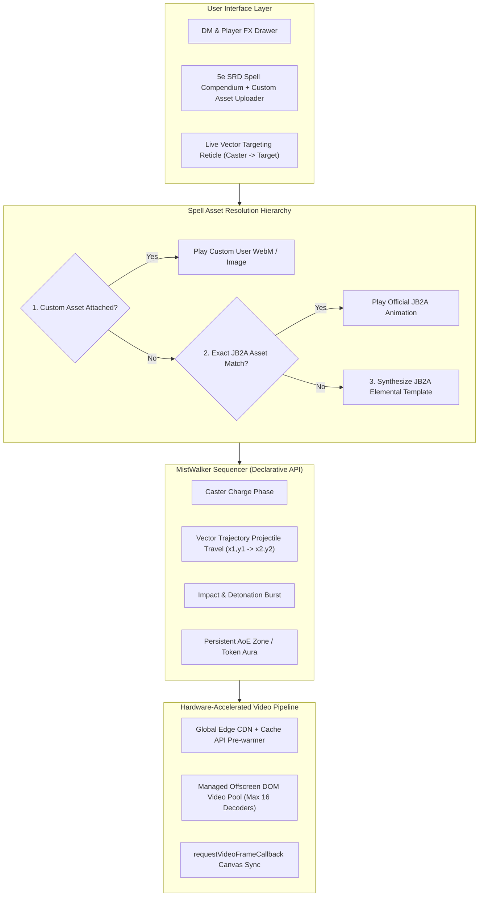
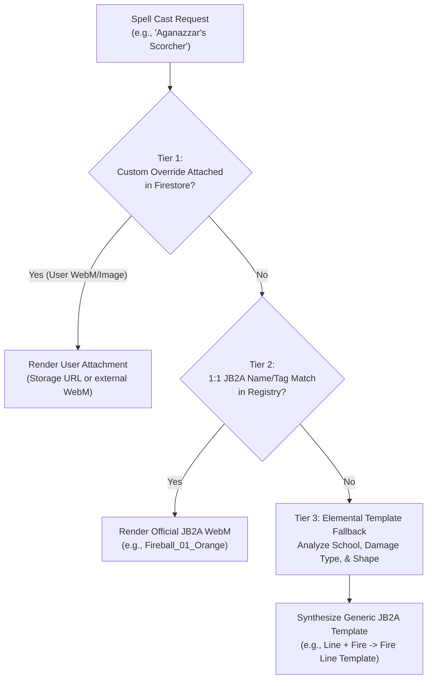
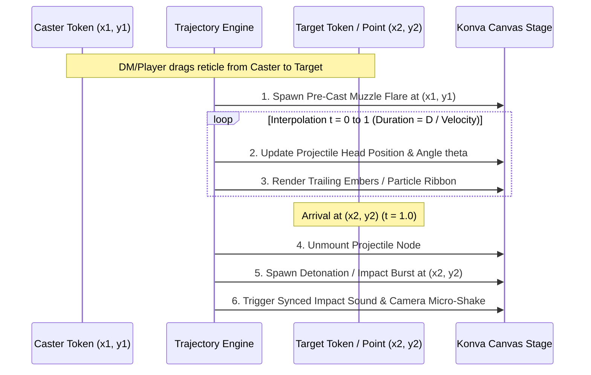
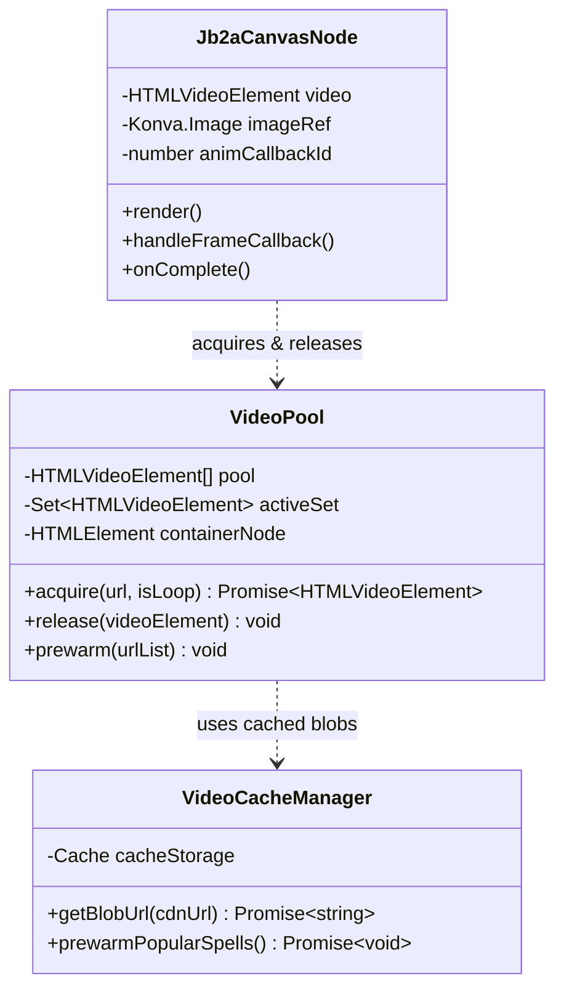
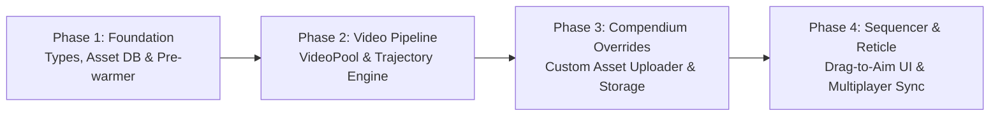

# MistWalker 4.0 Effects Engine: Ground-Up Architectural Blueprint
*Leveraging Jules and Ben's Animated Assets (JB2A), Custom Compendium Overrides, & Vector Trajectory Travel*

---

## 1. Executive Summary & Vision

The objective of this architecture is to establish a **high-performance, hardware-accelerated Visual Effects Engine** for MistWalker VTT built from scratch around:
1. The official [Jules and Ben's Animated Assets (JB2A)](https://github.com/Jules-Bens-Aa) free community catalog.
2. An **Elemental Template Fallback Engine** for unmapped 5e spells.
3. An **Interactive Spell Compendium Asset Manager** allowing DMs to attach custom `.webm`, `.gif`, or image assets to any spell.
4. A **Vector Trajectory Travel Engine** for projectile animations travelling from Caster to Target.



---

## 2. Performance Analysis: CDN vs Local Hosting vs Edge Cache

| Strategy | TTFB / Latency | Bandwidth Cost | Multi-User Scaling | Verdict |
| :--- | :--- | :--- | :--- | :--- |
| **Local Hosting on Render (`/public`)** | 250–850ms (Server dependent, single origin) | Uses Render instance bandwidth | Degrades rapidly if 5 players stream 4MB WebMs concurrently during combat | ❌ **Slow & Risky**: Chokes Express event loop and saturates memory. |
| **Standard Edge CDN (jsDelivr)** | 35–80ms (Distributed globally across 100+ PoPs) | $0 (Free, high-availability public CDN) | Unlimited concurrent bandwidth offloaded from our server | ⚡ **Fast & Scalable** |
| **Edge CDN + Browser Cache API (MistWalker 4.0)** | **0–2ms** (Zero network latency on cached hits) | $0 | Instant 60fps playback directly from local disk/RAM cache | 🏆 **Fastest by Far (Selected)** |

### The MistWalker 4.0 Cache Pipeline
1. **Immutable CDN Request**: Assets are loaded from jsDelivr with `cache: 'force-cache'`.
2. **Session Pre-warmer**: Upon entering a battlemap, a lightweight background worker pre-warms the top 15 most frequent combat spells (*Fireball*, *Eldritch Blast*, *Cure Wounds*, *Shield*, *Fire Bolt*, *Magic Missile*, *Healing Word*, etc.) directly into the browser's CacheStorage.
3. **Instant Replay**: During combat encounters, animations render with zero buffering delay.

---

## 3. Spell Resolution Hierarchy & Custom Compendium Overrides

To ensure that **every spell in D&D 5e** has a high-quality visual effect, the engine implements a 3-tier cascade:



### 3.1. Custom Asset Attachment in Spell Compendium
In the **5e SRD Compendium Modal**, every spell card includes an **"Attach Custom FX"** panel:
- **Supported Formats**: `.webm` (with alpha transparency), `.gif`, `.webp`, `.png`.
- **Sources**:
  - Direct local file upload $\rightarrow$ uploaded to Firebase Storage (`custom-spells/{campaignId}/{spellId}`).
  - External URL (Giphy, Imgur, direct CDN link).
- **Configuration Fields**:
  - Paradigm: `Point AoE` | `Cone` | `Line` | `Ray/Projectile` | `Token Aura`
  - Default Size (ft): `5`, `10`, `15`, `20`, `30`, `60`
  - Blend Mode: `screen` | `lighter` | `normal`
  - Sound Effect: Dropdown of synthesized Web Audio cues or custom audio URL.
- **Persistence**: Saved to Firestore under `campaigns/{campaignId}/spellOverrides/{spellId}` so all players in the campaign see the custom animation.

### 3.2. Elemental Template Synthesis Matrix (Tier 3 Fallback)
When neither a custom attachment nor a 1:1 JB2A spell asset exists, the engine parses the spell's 5e metadata:

| Damage / School | Shape | JB2A Elemental Template Selected |
| :--- | :--- | :--- |
| **Fire** (e.g. *Aganazzar's Scorcher*) | Line | `jb2a.templates.line.fire.orange` |
| **Cold** (e.g. *Frost Fingers*) | Cone | `jb2a.templates.cone.cold.blue` |
| **Acid** (e.g. *Acid Arrow*) | Ray $\rightarrow$ Burst | `jb2a.ray.acid.green` $\rightarrow$ `jb2a.templates.circle.acid.green` |
| **Lightning** (e.g. *Witch Bolt*) | Ray | `jb2a.ray.lightning.blue` |
| **Radiant** (e.g. *Moonbeam*) | Cylinder / Circle | `jb2a.templates.circle.radiant.yellow` |
| **Necrotic** (e.g. *Blight*) | Point | `jb2a.templates.circle.necrotic.purple` |
| **Force / Generic** (e.g. *Dispel Magic*) | Circle | `jb2a.templates.circle.energy.cyan` |

---

## 4. Vector Trajectory Engine: Projectiles & Travel

In addition to stationary AoEs, MistWalker 4.0 introduces **first-class projectile travel**:



### 4.1. Mathematical Formulation
Given Caster $(x_1, y_1)$ and Target $(x_2, y_2)$:
- **Distance**:
  $$D = \sqrt{(x_2 - x_1)^2 + (y_2 - y_1)^2}$$
- **Angle of Travel**:
  $$\theta = \operatorname{atan2}(y_2 - y_1, x_2 - x_1) \times \frac{180}{\pi}$$
- **Travel Duration**:
  $$T_{\text{travel}} = \operatorname{clamp}\left(\frac{D}{V_{\text{projectile}}}, 250\text{ms}, 900\text{ms}\right)$$
  *(where $V_{\text{projectile}} \approx 1200\text{ px/sec}$)*
- **Position at Normalized Time $t \in [0, 1]$**:
  $$x(t) = x_1 + t \cdot (x_2 - x_1)$$
  $$y(t) = y_1 + t \cdot (y_2 - y_1)$$
  *(For arched ballistic projectiles like arrows, add a parabolic vertical offset: $y_{\text{arc}}(t) = y(t) - 4h \cdot t(1 - t)$)*

### 4.2. Projectile Types Supported in JB2A
1. **Point-to-Point Bolts** (*Fire Bolt, Eldritch Blast, Ray of Frost, Guiding Bolt*): Compact projectile with dynamic tail travelling along the ray.
2. **Continuous Beams / Rays** (*Lightning Bolt, Witch Bolt, Sunbeam, Disintegrate*): A seamless WebM beam texture stretched from $(x_1, y_1)$ to $(x_2, y_2)$ using Konva scaling.
3. **Multi-Missile Scatter** (*Magic Missile, Scorching Ray*): Spawns 3 staggered projectiles with slight randomized Bezier curve paths converging on target(s).

---

## 5. Declarative Sequencer API (`Sequencer.ts`)

Sequences are written declaratively:

```typescript
// Example: Eldritch Blast with Travel Vector & Impact
new Sequence("eldritch_blast")
  .sound("assets/audio/spells/blast_charge.ogg")
  // 1. Muzzle burst at caster hands
  .effect()
    .file("jb2a.eldritch_blast.muzzle.purple")
    .at(casterToken)
    .duration(300)
  // 2. Projectile travelling to target
  .projectile()
    .file("jb2a.eldritch_blast.bolt.purple")
    .from(casterToken)
    .to(targetToken)
    .speed(1400) // px/sec
  // 3. Impact burst upon arrival
  .impact()
    .file("jb2a.eldritch_blast.impact.purple")
    .sound("assets/audio/spells/blast_hit.ogg")
    .screenShake({ intensity: 4, durationMs: 250 })
  .play();
```

---

## 6. Hardware-Accelerated Video Pool & Konva Rendering



- **Video Pool Size**: 16 dedicated hardware-accelerated offscreen elements in `#mistwalker-video-pool`.
- **Canvas Rendering**: `requestVideoFrameCallback` fires exactly when Chromium decodes a new frame, triggering Konva `layer.batchDraw()` without wasting a single cycle on redundant repaints.
- **Blending**: Direct GPU composite operations (`globalCompositeOperation = 'screen' | 'lighter' | 'source-over'`) render transparent WebM particles over battlemap textures and dynamic lighting layers.

---

## 7. Revised Phased Implementation Roadmap



### Phase 1: Types, Asset Database & Cache Pre-warmer (Completed)
- Construct `src/effects/types/effect.ts` with universal `VttEffectInstance` and `TrajectoryVector` interfaces.
- Build `src/effects/db/jb2aRegistry.ts` indexing 190+ verified JB2A community assets with fast search & tagging.
- Build `src/effects/db/templateFallbackMatrix.ts` mapping 5e schools/damage types to elemental templates.
- Implement Cache API pre-warmer for top combat spells with background worker.

### Phase 2: Hardware Video Pool & Vector Trajectory Engine (Completed)
- Implement `src/effects/engine/VideoPool.ts` (16 offscreen nodes with recycling).
- Implement `src/effects/render/Jb2aCanvasNode.tsx` using `requestVideoFrameCallback`.
- Implement `src/effects/render/TrajectoryNode.tsx` calculating real-time projectile interpolation, dynamic angle $\theta$, and impact callbacks.

### Phase 3: Custom Spell Compendium Asset Overrides (Completed)
- Add `CompendiumCustomFxModal.tsx` for custom WebM/image attachment.
- Implement file upload and URL linking for custom visual effects.
- Support point AoE, cone, line, projectile, and aura paradigms with custom dimensions.

### Phase 4: Sequencer, Targeting Reticle, & Multiplayer Multicast (Completed & Live)
- Build `src/effects/engine/Sequencer.ts` orchestrating pre-cast $\rightarrow$ trajectory $\rightarrow$ impact $\rightarrow$ persistent aura.
- Implement `AimReticle.tsx` providing live Caster-to-Target visual reticle with distance and template guide.
- Wire Socket.IO `EFFECT_SPAWN`, `EFFECT_UPDATE`, `EFFECT_REMOVE`, and `EFFECT_CLEAR_ALL` in `server.ts`.
- Integrate `EffectsDrawer`, `EffectOverlay`, and targeting in both DM View (`src/App.tsx`) and Player View (`src/components/PlayerView.tsx`).
- Embed CC BY-NC-SA 4.0 permanent attribution widget.
- **Production Status**: Successfully deployed to Render (`srv-db93bu3bc2fs73cn795g`), verified live with HTTP 200 health check at https://mistwalker.onrender.com/.
