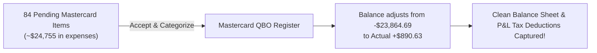

# Forensic Audit Report: Mastercard Balance Discrepancy

**Company:** Active Drone Solutions Inc.  
**Account Audited:** Credit Card — `Mastercard` (QBO ID: `1150040001`)  
**Actual Bank Balance (from RBC Mastercard Feed):** **$890.63** (Total amount owed on card)  
**QuickBooks Online Register Balance:** **-$23,864.69** (Shows as an unnatural negative liability/credit)  
**Total Discrepancy:** **$24,755.32**

---

## Executive Summary: Why the Credit Card is -$23,864.69

In QuickBooks, a credit card is a **Liability** account:
- When you make a **Purchase / Charge** on the card, it **increases** the liability (you owe more).
- When you make a **Payment** from Checking to the card, it **decreases** the liability (you owe less).

### What Happened in Your Books:
1. **Payments were faithfully recorded:**  
   Every time you transferred money from your RBC Chequing (9478) to pay off the Mastercard, QBO recorded the payment. Total payments recorded in QBO: **$52,594.49**.
2. **The Purchases were NOT accepted into QBO:**  
   Only **$28,729.80** of card purchases were actually added to QuickBooks.
3. **The Result:**  
   QuickBooks thinks you paid **$52,594.49** toward a card that only had **$28,729.80** in purchases, leaving an unnatural negative balance of:
   $$\$28,729.80 - \$52,594.49 = -\$23,864.69$$

---

## Where Are the Missing Purchases? (The "84" in your screenshot!)

The missing **\$24,755.32** in expenses are **currently sitting unaccepted in your "84 items waiting for review" on the Mastercard bank feed**!

From your October 2026 Mastercard Statement:
- **Google Ads & Workspace:** \$103.32, \$412.03, \$34.40
- **DJI Equipment / Software:** \$374.55
- **Rogers Communications:** \$236.90
- **Fuel (Mobil, Esso):** \$129.15, \$21.00
- **Parking (Calgary Parking Authority, Impark):** \$100.00, \$35.18, \$29.40, \$29.00
- **Meals & Travel (Barbarella Bar, Earls):** \$225.54, \$94.16
- **Software Subscriptions (Gamma.app, Apollo, etc.):** \$17.53, etc.

Because these expenses were never confirmed in the bank feed:
1. Your credit card balance has stayed artificially negative (**-\$23,864.69**).
2. **More importantly:** Your business is currently **missing out on ~$24,700 in tax-deductible expenses** (Advertising, Fuel, Travel, Phone, Subscriptions) that haven't been claimed in your Profit & Loss!

---

## How to Fix It: Complete 2-Step Reconciliation

1. **Step 1: Categorize the 84 Card Transactions**
   - We will categorize each expense to its proper deduction account (`Advertising`, `Dues & Subscriptions`, `Automobile - Fuel`, `Travel/Meals`, `Telephone`).
2. **Step 2: Watch the Balance Auto-Correct**
   - As those 84 items are added, the register will absorb the \$24,755.32 in expenses, shifting the balance from **-\$23,864.69** right back up to the actual statement balance of **+$890.63**.
