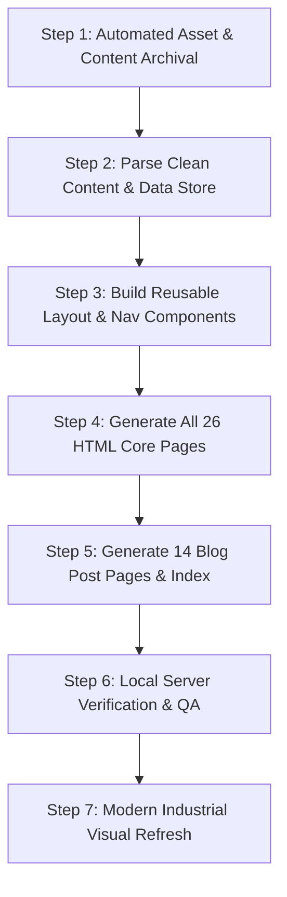

# Active Drone Solutions – Rebuild & Modernization Plan

## Project Objective
Rebuild **Active Drone Solutions** (`www.active-drones.com`) locally from its current GoDaddy Website Builder setup into a fast, modern, and completely self-contained static architecture (HTML5, modern CSS, Vanilla JS). 

All imagery, media, copy, metadata, and blog posts will be archived locally so zero content is lost. The site will be built in two clean stages:
1. **Phase 1: Complete 1:1 Preservation & Internal Rebuild**
2. **Phase 2: Visual Refresh & Modernization Preparation**

---

## Site Inventory Breakdown

### Core Website Pages (26 Pages)
1. `/` & `/home` - Homepage
2. `/oil-%26-gas` - Oil & Gas Drone Services
3. `/pipeline-row-inspections` - Pipeline ROW Inspections
4. `/pipeline-row-inspections-1` - Pipeline ROW Secondary View
5. `/leak-detection` - Methane & Gas Leak Detection
6. `/slope-monitoring` - Slope Stability & Geotechnical Monitoring
7. `/geohazard-identification` - Pipeline Geohazard Identification
8. `/mapping-%26-survey` - Drone Mapping & Surveying
9. `/topographic-mapping` - Topographic Mapping
10. `/b-v-l-o-s-1` - Beyond Visual Line of Sight (BVLOS)
11. `/autonomous-drones` - Autonomous Drone-in-a-Box Solutions
12. `/flare-stack-inspections` - Flare Stack & Thermal Inspections
13. `/energy` - Energy Sector Solutions
14. `/railway` - Railway Infrastructure Inspections
15. `/construction` - Construction Site Progression & Volume Analysis
16. `/agriculture` - Precision Agriculture
17. `/ndvi-vegetation-health` - NDVI & Crop Health Analysis
18. `/security-1` - Site Security & Perimeter Surveillance
19. `/other-drone-solutions` - Custom Drone Operations
20. `/videos` - Video Showcase & Flight Operations
21. `/info-brochure-1` - Brochure & Downloadable Specs
22. `/logo-and-images` - Media & Brand Assets
23. `/blog` - Blog Index
24. `/contact-us` - Contact & Quote Request Form
25. `/booking-complete` - Booking Confirmation
26. `/web-info-privacy-policy` - Privacy Policy & Terms

### Blog Articles (14 Articles)
1. `analysis-ready-data-the-shift-to-ai-driven-pipeline-monitoring`
2. `april-1st-methane-deadline-navigating-the-2026-mandate`
3. `why-methane-detection-is-shifting-from-specialists-to-uavs`
4. `bvlos-drone-regulations-in-canada-a-guide-to-autonomous-uav-ops`
5. `how-drones-are-transforming-railway-inspections`
6. `7-key-benefits-of-drone-in-the-box-systems-for-oil-gas`
7. `revolutionizing-mapping-surveying-in-alberta-with-lidar-drones`
8. `slope-stability-monitoring-for-oil-and-gas-projects-in-alberta`
9. `revolutionizing-oil-gas-inspections-with-thermal-imaging-drones`
10. `benefits-of-using-drones-for-pipeline-geohazard-identification`
11. `drones-and-lidar`
12. `how-drones-are-helping-to-reduce-fugitive-emissions`
13. `how-farmers-are-using-drones-to-increase-crop-yields`
14. `how-drones-can-be-used-for-pipeline-inspections`

---

## Execution Milestones



### 1. Automated Asset & Content Archival
- Scrape each page's raw HTML and extract text content, metadata, headings, paragraphs, and list items.
- Identify all image URLs (including GoDaddy CDN `img1.wsimg.com`, Vimeo thumbnails, hero backgrounds, brand logos, favicons).
- Download all media directly into `assets/images/`, `assets/videos/`, and `assets/docs/` with deduplicated naming.
- Update all image references to point to local relative paths.

### 2. Modern Static Architecture Structure
```
g:/ADS/Media/Web/Website 2026 Update/
├── assets/
│   ├── css/
│   │   ├── style.css          (Clean, modern responsive stylesheet)
│   │   └── modern-theme.css   (Industrial aesthetic enhancements)
│   ├── js/
│   │   ├── main.js            (Mobile menu, modal, scroll animations)
│   │   └── contact.js         (Form validation & lead handling)
│   ├── images/                (All downloaded original imagery & icons)
│   └── docs/                  (Brochures, PDF downloads)
├── data/
│   ├── pages.json             (Extracted structured content for all pages)
│   └── posts.json             (Extracted blog posts content & metadata)
├── blog/
│   ├── index.html             (Blog directory)
│   └── *.html                 (14 individual blog articles)
├── *.html                     (All 26 core pages)
└── index.html                 (Homepage)
```

### 3. Visual Modernization Upgrades
- High-contrast, sharp industrial aesthetic reflecting aerospace & drone engineering (charcoal, slate, neon/emerald green accent `#439c48` matching brand identity).
- Modern responsive navigation bar with clear desktop dropdowns and seamless mobile drawer.
- Fast loading with zero heavy external tracking dependencies.
- Clear call-to-actions ("Request a Flight / Quote", "Contact Drone Specialists").
- Ready for immediate one-command deployment to any future hosting environment (Netlify, Vercel, Firebase Hosting, Apache, or AWS S3).
