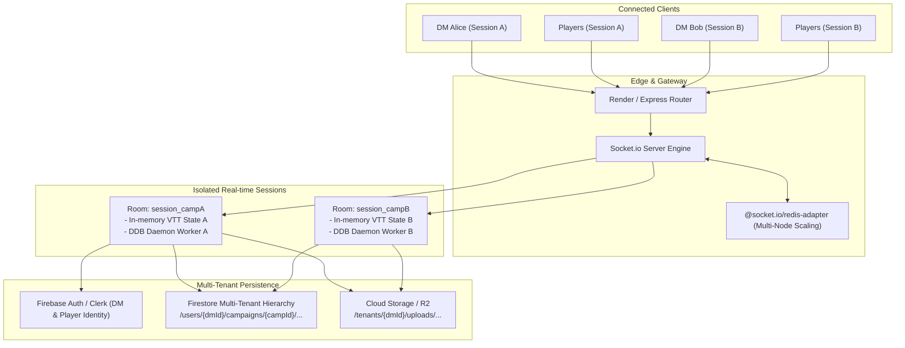
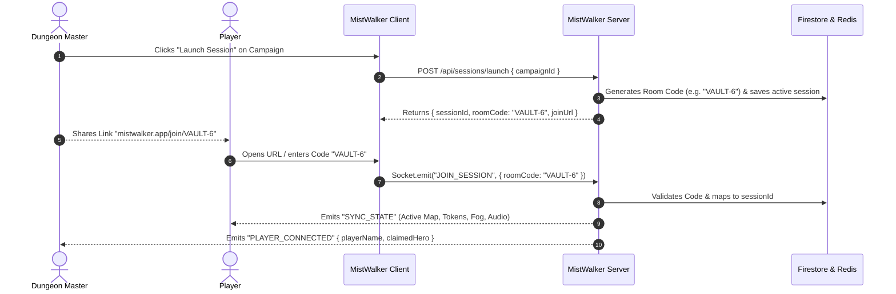
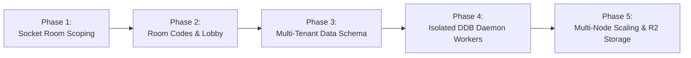

# MistWalker Multi-DM & Multi-Campaign Concurrent Architecture Blueprint

## 1. Executive Summary

MistWalker is currently architected as a **single-session authoritative VTT**:
- One global in-memory server state (`activeVttState` in `server.ts`).
- Global WebSocket broadcasts (`socket.broadcast.emit`).
- Single-tenant Firestore collections (`campaigns`, `activeSession`, `uploadedAssets`).
- Singleton D&D Beyond polling daemon (`DdbHpSyncDaemon`) bound to one shared server process.

To support **multiple DMs running independent campaign groups simultaneously**, MistWalker must transition to a **multi-tenant, room-isolated architecture**. In this model, arbitrary DMs can host independent sessions (e.g. DM Alice running *Keys from the Golden Vault* and DM Bob running *Curse of Strahd* concurrently) without state cross-contamination, audio leakage, or asset interference.



---

## 2. Current Architecture vs. Target Multi-DM Architecture

| Dimension | Current Architecture | Target Multi-Tenant Architecture |
| :--- | :--- | :--- |
| **Session Scoping** | Global singleton in `server.ts` (`activeVttState`). Any state change updates all connected browsers. | **Room-scoped sessions** via `socket.join(sessionRoomId)`. State isolated strictly per campaign session. |
| **WebSockets** | Flat `socket.broadcast.emit(...)` | Target-routed `io.to(sessionId).emit(...)` with per-room state bags. |
| **Authentication** | Anonymous auto-sign-in; role chosen via URL query (`?role=dm`). | **User Identity Layer** (Firebase Auth or Clerk) with explicit Roles (`dm`, `co_dm`, `player`, `spectator`). |
| **Campaign Storage** | Flat collections: `/campaigns/{id}`, `/uploadedAssets/{id}`. | **Hierarchical Tenant Schema**: `/tenants/{dmUserId}/campaigns/{campaignId}/...` with granular Firestore Security Rules. |
| **Media / File Uploads** | Flat local `/uploads/` directory on single server disk. | Scoped Cloud Storage (Firebase Storage / Cloudflare R2 / AWS S3) under `/tenants/{dmId}/campaigns/{campaignId}/`. |
| **D&D Beyond Daemon** | Singleton daemon polling one or two hardcoded campaigns (`6738033`, `3290944`). | **Dynamic Multi-Session Poller Manager**: Independent per-campaign polling workers spawned only when a session is active. |
| **Join Experience** | URL query parameters (`/?role=player`). | **6-Character Room Codes & Short Links** (e.g. `mistwalker.vtt/join/GOLD-77` or `/session/:sessionId`). |

---

## 3. Core Architectural Pillars

### Pillar 1: Real-Time Session Isolation (Socket.io Rooms)
In Socket.io, each connected socket joins a room corresponding to the campaign session:

```typescript
// server/socketSessionManager.ts
export interface SessionRoomState {
  sessionId: string;
  campaignId: string;
  dmUserId: string;
  activeSceneId: string;
  vttState: ActiveVttState;
  connectedSockets: Set<string>;
  ddbSyncDaemon?: DdbSessionSyncWorker;
}

// On client connect
socket.on("JOIN_SESSION", async ({ sessionId, roomCode, tokenClaim, role }) => {
  const session = await sessionRegistry.resolveSession(sessionId || roomCode);
  if (!session) {
    return socket.emit("JOIN_ERROR", { message: "Invalid session or room expired" });
  }

  socket.join(session.sessionId);
  socket.data.sessionId = session.sessionId;
  socket.data.role = role; // 'dm' | 'player'
  socket.data.userId = authUser.uid;

  // Send ONLY this session's current state to the joining client
  socket.emit("SYNC_STATE", session.vttState);

  // Notify other members of this room ONLY
  socket.to(session.sessionId).emit("USER_JOINED", {
    userId: authUser.uid,
    role,
    socketId: socket.id
  });
});

// All event handlers become room-scoped:
socket.on("MOVE_TOKEN", (data) => {
  const roomId = socket.data.sessionId;
  if (!roomId) return;
  sessionRegistry.updateTokenPosition(roomId, data);
  socket.to(roomId).emit("MOVE_TOKEN", data);
});
```

> [!IMPORTANT]
> By scoping all broadcasts through `socket.to(roomId).emit(...)`, multiple DMs and dozens of player groups can play simultaneously without packet collision or cross-talk.

---

### Pillar 2: Horizontal Scaling with Socket.io Redis Adapter
When traffic grows across multiple DMs, a single Node.js process will encounter CPU caps (especially during heavy 200-wall raycasting or concurrent PDF ingestions).
- **Pre-built Module**: `@socket.io/redis-adapter` + `ioredis` (or Upstash Redis serverless).
- **How it works**: Socket.io instances across multiple server nodes connect to a shared Redis Pub/Sub channel. If DM Alice is connected to Server Node 1 and Player Bob is connected to Server Node 2, Redis seamlessly routes room packets between nodes.

---

### Pillar 3: Multi-Tenant Data Modeling in Firestore

The current root collections (`/campaigns`, `/uploadedAssets`, `/monsters`) should transition to a partitioned schema:

```
/users/{dmUserId}                          <-- DM Account Profile & Subscription Tier
    /campaigns/{campaignId}                <-- Owned Campaigns
        /chapters/{chapterId}
            /scenes/{sceneId}
        /sessions/{sessionId}              <-- Live / Saved Game Sessions
            /tokens
            /walls
            /drawings
            /fogReveals
        /assets/{assetId}                  <-- DM's Custom Audio, Video & Map Assets
        /characters/{characterId}          <-- Campaign Character Rosters

/sessions/{sessionId}                      <-- Active Live Session Pointer (Lookup by 6-char Room Code)
    roomCode: "GOLD-77"
    dmUserId: "user_scott_123"
    campaignId: "camp_golden_vault"
    activeSceneId: "scene_guildhouse_main"
    isActive: true
    allowSpectators: false
    createdAt: 1730100000000
```

#### Firestore Security Rules for Multi-Tenant Isolation
```javascript
rules_version = '2';
service cloud.firestore {
  match /databases/{database}/documents {
    
    // Helper functions
    function isAuthenticated() {
      return request.auth != null;
    }
    function isOwner(userId) {
      return isAuthenticated() && request.auth.uid == userId;
    }
    function isSessionMember(sessionId) {
      return isAuthenticated() && (
        request.auth.uid in get(/databases/$(database)/documents/sessions/$(sessionId)).data.memberUids
      );
    }

    // DM owns their campaigns and assets
    match /users/{dmUserId}/campaigns/{campaignId} {
      allow read: if isAuthenticated();
      allow write: if isOwner(dmUserId);

      match /{subcollection=**} {
        allow read: if isAuthenticated();
        allow write: if isOwner(dmUserId);
      }
    }

    // Active sessions: DM writes, participating players read & update their claimed token
    match /sessions/{sessionId} {
      allow read: if isAuthenticated();
      allow create: if isAuthenticated();
      allow update, delete: if isOwner(resource.data.dmUserId) || isSessionMember(sessionId);
    }
  }
}
```

---

### Pillar 4: Multi-Tenant D&D Beyond Sync Engine

Currently, `DdbHpSyncDaemon` runs as a singleton process with one global polling loop.
In a multi-DM ecosystem:
1. **Per-DM DDB Credentials**: Each DM connects their own D&D Beyond account (Cobalt Cookie or Campaign Link) stored encrypted in their private user document (`/users/{dmUserId}/private/ddbCredentials`).
2. **Dynamic Poller Pool (`DdbPollerManager`)**:
   - Instead of continuously polling all campaigns on boot, pollers are **instantiated on-demand** when a session opens.
   - When DM Alice launches a session with campaign ID `6738033`, a worker is assigned to `session_campA`.
   - Polling runs at 3.5s intervals *only for active sessions with connected players*, idling down when all users disconnect to preserve rate limits and host memory.

---

### Pillar 5: Room Code Lobby & Join Flow



---

## 4. Recommended Pre-Built Modules & Existing Support

| Requirement | Recommended Pre-built Technology / Library | Why Adopt Instead of Building From Scratch |
| :--- | :--- | :--- |
| **Authentication & User Profiles** | **Firebase Auth** (Already in project) or **Clerk** | Turnkey email/pass, Google OAuth, Discord sign-in, anonymous-to-permanent account linking, and JWT token verification. |
| **Multi-Node WebSocket Scaling** | **`@socket.io/redis-adapter`** | Industry-standard clustering adapter for Socket.io. Zero-code synchronization between multiple server workers. |
| **Serverless Redis** | **Upstash Redis** (`@upstash/redis` or `ioredis`) | Generous free tier, REST/TCP interfaces, zero server maintenance, handles pub/sub and room registry. |
| **Storage & Content Delivery** | **Cloudflare R2** via `@aws-sdk/client-s3` | **Zero egress fees** for high-resolution 4K battlemaps and animated WebM videos (Firebase Storage egress gets expensive at scale). |
| **State Management Isolation** | **Zustand** (with scoped session stores) | Clean replacement for massive React component prop drilling, allows isolated multi-room testing. |
| **Room Code Generator** | **`nanoid`** or **`custom-id`** | Generates human-friendly, high-entropy 6-character room codes (e.g. `MIST-9X`) without collision. |
| **Rate Limiting & Abuse Prevention** | **`express-rate-limit`** + **`helmet`** | Prevents denial-of-service on upload endpoints and brute-forcing room codes. |

---

## 5. Five-Phase Restructuring Roadmap



### Phase 1: Socket.io Room Scoping (Lowest Risk / High Immediate Payoff)
- Add `sessionId` parameter to all Socket.io events (`SYNC_STATE`, `MOVE_TOKEN`, `SYNC_IMAGE`, `MAP_PING`, etc.).
- Update `server.ts` to replace `socket.broadcast.emit` with `socket.to(sessionId).emit`.
- Default existing single-session mode to `sessionId = 'default'` so current gameplay is 100% backward compatible during development.

### Phase 2: Room Code Generation & Lobby UI
- Create `/join/:roomCode` dynamic route and Join Screen modal.
- Implement session creation API (`POST /api/sessions/create`) generating a unique 6-character code (e.g., `MIST-44`).
- Add a "Host Live Game" button to the Campaign Management Bar.

### Phase 3: Multi-Tenant Firestore Migration
- Migrate flat `/campaigns` and `/uploadedAssets` paths to `/users/{userId}/campaigns/{campaignId}`.
- Deploy updated Firestore Security Rules with ownership verification.
- Implement an automated one-time migration script for existing local campaigns into the authenticated user's namespace.

### Phase 4: Dynamic D&D Beyond Worker Isolation
- Refactor `DdbHpSyncDaemon` into a factory class (`DdbSessionWorker`).
- Spawn workers dynamically when a room with linked DDB campaigns connects; clean up worker intervals when the room goes empty.
- Store DDB Cobalt Session tokens encrypted in the DM's secure settings subcollection.

### Phase 5: High-Capacity Cloud Infrastructure
- Switch large media uploads to Cloudflare R2 / S3 with signed URLs (bypassing Express memory buffers).
- Configure `@socket.io/redis-adapter` with Upstash Redis for multi-instance clustering on Render.

---

## 6. Key Architecture Decisions & Next Steps

1. **Authentication Provider**: 
   - *Option A (Recommended)*: Leverage the **Firebase Auth** SDK already integrated in MistWalker (add Google + Discord social sign-in and anonymous upgrade).
   - *Option B*: Integrate **Clerk** or **Supabase Auth** for dedicated user-management dashboards.
2. **Storage Strategy**:
   - Keep local disk uploads for staging, but adopt **Cloudflare R2** for production to eliminate bandwidth charges when hosting dozens of simultaneous campaigns.
3. **Execution Readiness**:
   - Would you like to begin with **Phase 1 (Socket.io Room Scoping)** so your friend can host a separate campaign on the same server right away?
