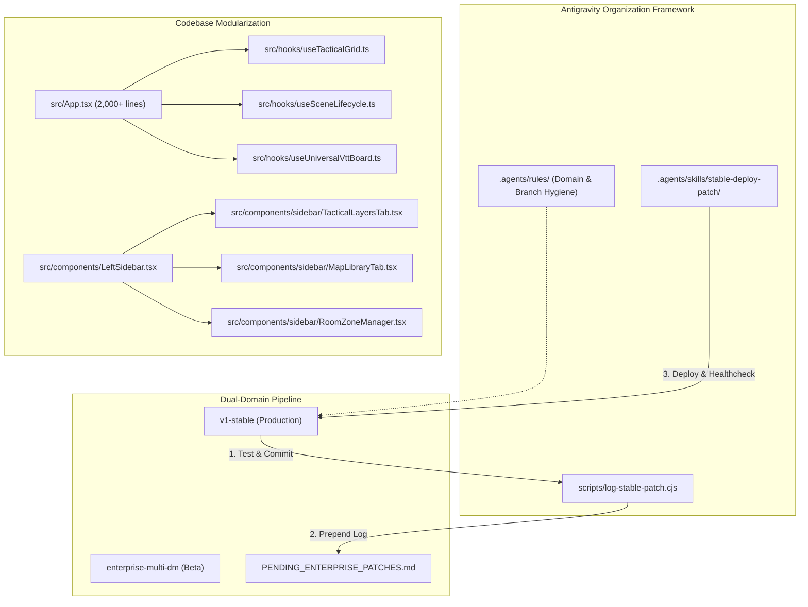

# MistWalker 3.0: Project Organization & Efficiency Implementation Plan

## Executive Summary
This plan outlines a concrete, phased roadmap to eliminate context bloat, safeguard the dual-domain deployment pipeline (`v1-stable` vs. `enterprise-multi-dm`), automate patch logging for [PENDING_ENTERPRISE_PATCHES.md](file:///g:/Scott/dnd/MistWalker/Mistwalker%203.0/PENDING_ENTERPRISE_PATCHES.md), and progressively modularize monolithic components ([src/App.tsx](file:///g:/Scott/dnd/MistWalker/Mistwalker%203.0/src/App.tsx) and [src/components/LeftSidebar.tsx](file:///g:/Scott/dnd/MistWalker/Mistwalker%203.0/src/components/LeftSidebar.tsx)) without disrupting active development.

---

## Architecture & Workflow Map

---

## Phase 1: Project Rules & Conversation Protocol (`.agents/rules/`)

Establish structured project rules so every agent session automatically adopts clear branch and conversation hygiene.

### 1.1 Create `.agents/rules/dual-domain-hygiene.md`
- **Conversation Isolation**:
  - `[Stable]` sessions: Exclusively for bug fixes, performance passes, and DM tools on `v1-stable`.
  - `[Enterprise]` sessions: Dedicated to multi-DM lobby, user auth, and commercial features on `enterprise-multi-dm`.
  - `[Batch Sync]` sessions: Dedicated to reviewing [PENDING_ENTERPRISE_PATCHES.md](file:///g:/Scott/dnd/MistWalker/Mistwalker%203.0/PENDING_ENTERPRISE_PATCHES.md) and executing coordinated merges.
- **Context Compaction Rule**:
  - Run `/compact` immediately when a session transitions from planning/debugging into deployment.
- **Reference Over History**:
  - Direct agents to use `@conversation` or link file paths instead of copying verbose paste logs across turns.

### 1.2 Create `.agents/rules/subagent-protocols.md`
- **Read Operations**: Force exploratory scans and multi-file greps to run via the read-only `research` subagent to keep main conversation context pristine.
- **Write Operations & Experiments**: Mandate `Workspace: 'branch'` for non-trivial refactoring or experimental subagents so local git worktrees remain clean.
- **Security Rules**: Author all `firestore.rules` modifications through `firestore-rules-author`.

---

## Phase 2: Automated Stable Deployment & Patch Logging

Currently, logging changes to [PENDING_ENTERPRISE_PATCHES.md](file:///g:/Scott/dnd/MistWalker/Mistwalker%203.0/PENDING_ENTERPRISE_PATCHES.md) is done manually, and running builds, git pushes, and Render deployments is a multi-step chore.

### 2.1 Implement `scripts/log-stable-patch.cjs`
A dedicated Node.js utility that:
1. Inspects the latest commit (`git log -1 --pretty=format:"%H|%s"` and `git diff-tree --no-commit-id --name-only -r HEAD`).
2. Extracts the commit hash, date (YYYY-MM-DD), commit title, and affected file list.
3. Formats the entry to match the existing convention in [PENDING_ENTERPRISE_PATCHES.md](file:///g:/Scott/dnd/MistWalker/Mistwalker%203.0/PENDING_ENTERPRISE_PATCHES.md).
4. Prepends the entry directly below the `## Pending Changes Queue for Future Enterprise Patch` header.

### 2.2 Create Custom Antigravity Skill: `.agents/skills/stable-deploy-patch/`
Creates a dedicated skill with `SKILL.md` that can be triggered via slash command or conversation:
- **Step 1: Build Verification**: Runs `npm run build` and halts if TypeScript or Vite fails.
- **Step 2: Git Push**: Pushes to `origin/v1-stable`.
- **Step 3: Auto-Log**: Executes `node scripts/log-stable-patch.cjs`.
- **Step 4: Render Deploy**: Triggers `node scripts/deploy.js --prod`.
- **Step 5: Live Verification**: Confirms `https://mistwalker.onrender.com/` returns HTTP 200.

---

## Phase 3: Monolith Modularization Roadmap (`App.tsx` & `LeftSidebar.tsx`)

Both [src/App.tsx](file:///g:/Scott/dnd/MistWalker/Mistwalker%203.0/src/App.tsx) and [src/components/LeftSidebar.tsx](file:///g:/Scott/dnd/MistWalker/Mistwalker%203.0/src/components/LeftSidebar.tsx) have become primary points of friction, growing unwieldy and causing frequent merge/context friction.

> [!IMPORTANT]
> Modularization will be performed incrementally in separate, verifiable steps. All current uncommitted files ([src/components/PlayerArenaMode.tsx](file:///g:/Scott/dnd/MistWalker/Mistwalker%203.0/src/components/PlayerArenaMode.tsx), [src/data/presetBattlemaps.ts](file:///g:/Scott/dnd/MistWalker/Mistwalker%203.0/src/data/presetBattlemaps.ts)) will be preserved.

### Step 3.1: Extract Tactical Hooks from `App.tsx`
- **`useTacticalGrid`**:
  - Encapsulate grid size, grid offset (`gridOffsetX`, `gridOffsetY`), snapping math, and box-tracing calibration logic.
- **`useSceneLifecycle`**:
  - Encapsulate scene switching, optimistic thumbnail resolution, and IndexedDB background syncing.
- **`useUniversalVttBoard`**:
  - Encapsulate parsing, wall rendering, door states, and dynamic lighting extraction.

### Step 3.2: Deconstruct `LeftSidebar.tsx` into Segmented Tabs
- Move tab contents into `src/components/sidebar/`:
  - `TacticalLayersTab.tsx` (Grid, walls, lights, background controls)
  - `RoomZoneManager.tsx` (Room polygon drawing, badge pills, room list filters)
  - `MapLibraryTab.tsx` (Preset maps, VTT repository browser, custom uploads)
- Keep `LeftSidebar.tsx` as a clean routing container under 200 lines.

---

## Phase 4: Verification & Operational Rollout

1. **Verify TypeScript Compilation**: Run `npm run build` after each file extraction to verify zero regressions.
2. **Test Patch Automation**: Run a dry-run test of `log-stable-patch.cjs` to confirm formatting parity with [PENDING_ENTERPRISE_PATCHES.md](file:///g:/Scott/dnd/MistWalker/Mistwalker%203.0/PENDING_ENTERPRISE_PATCHES.md).
3. **Verify Skill Registration**: Confirm Antigravity recognizes `.agents/skills/stable-deploy-patch`.

---

## Proposed Execution Order

1. **Step 1**: Create `.agents/rules/` (`dual-domain-hygiene.md` and `subagent-protocols.md`).
2. **Step 2**: Create `scripts/log-stable-patch.cjs` and the `.agents/skills/stable-deploy-patch/` skill.
3. **Step 3**: Begin Phase 3 modularization by extracting `useTacticalGrid` and testing compilation.
