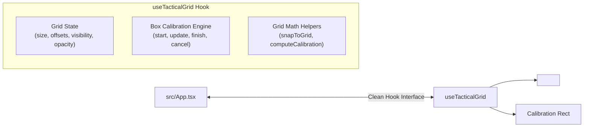

# Implementation Plan: Phase 3 (Step 3.1) & Phase 4

## Objective
Extract tactical grid state, grid offsets, and interactive box-tracing calibration logic from [src/App.tsx](file:///g:/Scott/dnd/MistWalker/Mistwalker%203.0/src/App.tsx) into a dedicated custom hook: **[`src/hooks/useTacticalGrid.ts`](file:///g:/Scott/dnd/MistWalker/Mistwalker%203.0/src/hooks/useTacticalGrid.ts)**, followed by complete Phase 4 build and operational verification.

---

## Technical Design: `src/hooks/useTacticalGrid.ts`



### 1. Encapsulated Responsibilities
- **Core Grid State**:
  - `gridSize: number` (default 50)
  - `gridOffsetX: number` (default 0)
  - `gridOffsetY: number` (default 0)
  - `gridVisible: boolean` (default true)
  - `gridOpacity: number` (default 0.3)
  - `gridOffsetRef: React.MutableRefObject<{ x: number; y: number }>` (for real-time pointer closures)
- **Interactive Box Calibration State**:
  - `gridCalibrateRect: { startX: number; startY: number; currentX: number; currentY: number } | null`
  - `isCalibratingGrid: boolean`
- **Actions**:
  - `startGridCalibration(point: { x: number; y: number })`: Initiates box tracing.
  - `updateGridCalibration(point: { x: number; y: number })`: Updates bounding box while dragging.
  - `finishGridCalibration(): { newSize: number; newOffsetX: number; newOffsetY: number } | null`: Computes exact measured pixel width/height (requiring $\ge 10\text{px}$), calculates the new `gridSize` and alignment offset snapping to the box's top-left corner, applies them to state, and cleans up the active rectangle.
  - `cancelGridCalibration()`: Resets calibration rectangle safely.
  - `resetGrid()`: Restores defaults (`50px`, `offset 0,0`).

---

## Integration Plan in `src/App.tsx`

1. **Import Hook**:
   ```tsx
   import { useTacticalGrid } from './hooks/useTacticalGrid';
   ```
2. **Initialize Hook**:
   Replace disparate `useState` declarations (lines 1343-1344 and 1370-1376) with a single invocation of `useTacticalGrid()`.
3. **Stage Event Wiring**:
   - In `handleStageMouseDown` (tool `'grid_calibrate'`): call `startGridCalibration(point)`.
   - In `handleStageMouseMove` (tool `'grid_calibrate'`): call `updateGridCalibration(point)`.
   - In `handleStageMouseUp` (tool `'grid_calibrate'`): call `finishGridCalibration()` which encapsulates size and offset calculation.
4. **Canvas Preview**:
   `gridCalibrateRect` remains identical in signature, so the Konva preview `<Rect>` and calibration dimension badges render with zero changes.

---

## Phase 4: Verification & Operational Rollout

1. **Compilation Verification Gate**:
   - Run `cmd.exe /c "npm run build"` to guarantee TypeScript type compatibility, zero Vite bundling regressions, and clean server bundling.
2. **Operational Validation**:
   - Verify that all consumer components (`LeftSidebar`, `GridLayer`, `TokenImage`, and room hotspot math) continue to receive unchanged `gridSize`, `gridOffsetX`, and `gridOffsetY` values.
3. **Git Hygiene**:
   - Stage and commit the cleanly modularized files to `v1-stable`.
