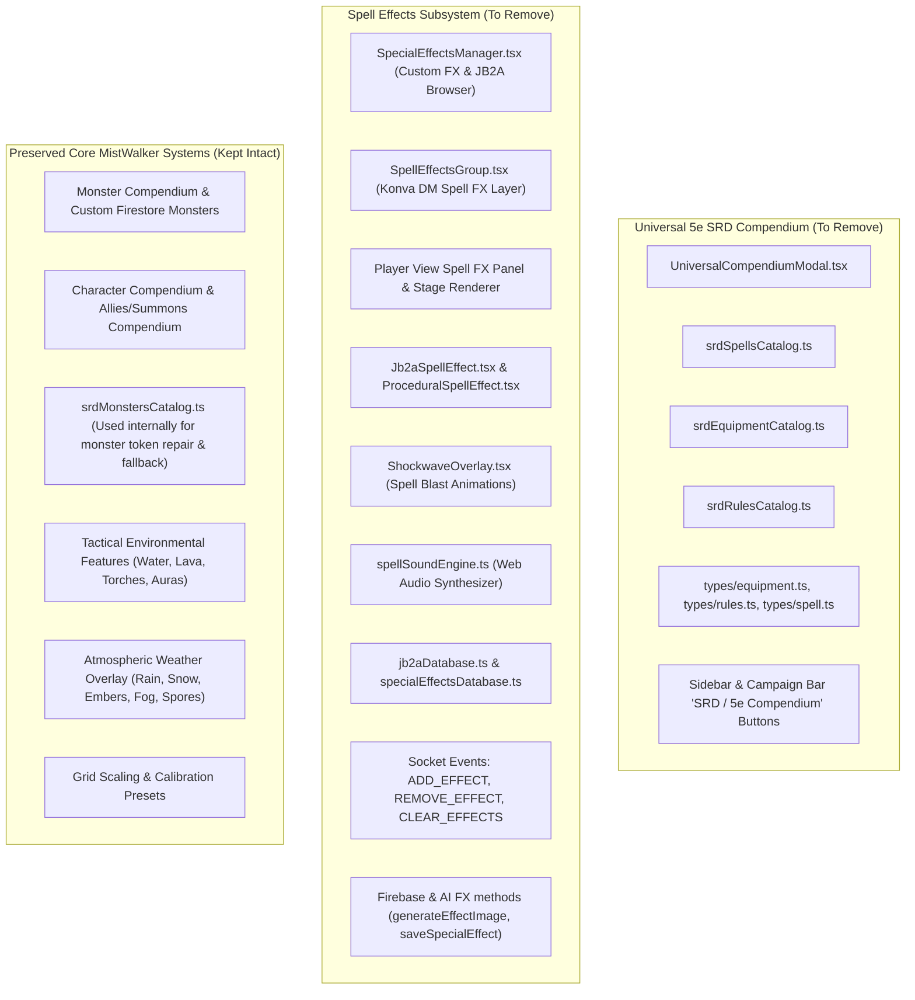

# Plan: Removal of Universal 5e SRD Compendium & Spell Effects

> [!NOTE]
> **Status:** Completed & Deployed Live ✅  
> **Commit Hash:** `a7aa405`  
> **Deploy ID:** `dep-dbb6mke7bikc73d906dg`  
> **Live Endpoint:** https://mistwalker.onrender.com (HTTP 200 OK)

This plan outlines the complete removal of the **Universal 5e SRD Compendium** and **all Spell Effects** across both the **DM View** and **Player View**, including UI elements, canvas rendering layers, audio synthesizers, socket sync events, backend handlers, and database/storage methods.

---

## Scope & Architectural Summary

---

## Detailed Removal Breakdown

### 1. Universal 5e SRD Compendium Removal

#### Files to Delete
- [`src/components/UniversalCompendiumModal.tsx`](file:///g:/Scott/dnd/MistWalker/Mistwalker%203.0/src/components/UniversalCompendiumModal.tsx)
- [`src/data/srdSpellsCatalog.ts`](file:///g:/Scott/dnd/MistWalker/Mistwalker%203.0/src/data/srdSpellsCatalog.ts)
- [`src/data/srdEquipmentCatalog.ts`](file:///g:/Scott/dnd/MistWalker/Mistwalker%203.0/src/data/srdEquipmentCatalog.ts)
- [`src/data/srdRulesCatalog.ts`](file:///g:/Scott/dnd/MistWalker/Mistwalker%203.0/src/data/srdRulesCatalog.ts)
- [`src/types/equipment.ts`](file:///g:/Scott/dnd/MistWalker/Mistwalker%203.0/src/types/equipment.ts)
- [`src/types/rules.ts`](file:///g:/Scott/dnd/MistWalker/Mistwalker%203.0/src/types/rules.ts)
- [`src/types/spell.ts`](file:///g:/Scott/dnd/MistWalker/Mistwalker%203.0/src/types/spell.ts)

> [!NOTE]
> `src/data/srdMonstersCatalog.ts` will **not** be deleted, because `repairMonsterToken()` and `resolveMonster()` are used internally by the server, token manager, and room briefing drawer to repair missing monster avatars and provide fallback statistics. Only the Universal Compendium's external browsing UI is removed.

#### DM View & App State Modifications
- **[`src/App.tsx`](file:///g:/Scott/dnd/MistWalker/Mistwalker%203.0/src/App.tsx)**:
  - Remove imports of `UniversalCompendiumModal`.
  - Remove states: `showUniversalCompendium`, `universalCompendiumTab`, `universalCompendiumQuery`.
  - Remove callback: `handleOpenUniversalCompendium`.
  - Remove `<UniversalCompendiumModal ... />` JSX.
  - Remove `onOpenUniversalCompendium` prop passed to `<LeftSidebar />` and `<MainCampaignBar />`.
  - Remove condition reference callback `onOpenConditionReference` passed to `<CombatTracker />`.
- **[`src/components/LeftSidebar.tsx`](file:///g:/Scott/dnd/MistWalker/Mistwalker%203.0/src/components/LeftSidebar.tsx)**:
  - Remove `onOpenUniversalCompendium` from props interface.
  - Remove the dedicated **SRD** sidebar rail button (`#group-btn-compendium`).
  - Remove the "Rules & Compendium" shortcuts ("SRD Rules", "Spellbook") in the Help flyout.
  - Remove "Browse 5e SRD Spell Compendium" button in the FX flyout.
- **[`src/components/MainCampaignBar.tsx`](file:///g:/Scott/dnd/MistWalker/Mistwalker%203.0/src/components/MainCampaignBar.tsx)**:
  - Remove `onOpenUniversalCompendium` prop.
  - Remove the **5e Compendium** navigation button (`#btn-main-open-universal-compendium`).
- **[`src/components/CombatTracker.tsx`](file:///g:/Scott/dnd/MistWalker/Mistwalker%203.0/src/components/CombatTracker.tsx) & [`src/components/CombatantRow.tsx`](file:///g:/Scott/dnd/MistWalker/Mistwalker%203.0/src/components/CombatantRow.tsx)**:
  - Clean up `onOpenConditionReference` prop. Condition badges remain clickable or static without attempting to open the removed compendium.

#### Player View Modifications
- **[`src/components/PlayerView.tsx`](file:///g:/Scott/dnd/MistWalker/Mistwalker%203.0/src/components/PlayerView.tsx)**:
  - Remove `UniversalCompendiumModal` import and state (`showUniversalCompendium`, `universalCompendiumTab`, `universalCompendiumQuery`).
  - Remove `<UniversalCompendiumModal ... />` modal JSX.
  - Remove "Spell Compendium" sidebar button.
  - Remove compendium spell casting and dice rolling handlers (`handleCastCompendiumSpell`, `handleRollCompendiumDice`).
  - Remove "Search in 5e Compendium" and "Full 5e Spell Compendium" banners.

---

### 2. Removal of All Spell Effects (DM & Player View)

#### Files to Delete
- [`src/components/SpecialEffectsManager.tsx`](file:///g:/Scott/dnd/MistWalker/Mistwalker%203.0/src/components/SpecialEffectsManager.tsx) (DM custom spell manager, library browser, AI generator)
- [`src/components/SpellEffectsGroup.tsx`](file:///g:/Scott/dnd/MistWalker/Mistwalker%203.0/src/components/SpellEffectsGroup.tsx) (Konva stage group for placed spell templates & animations)
- [`src/components/Jb2aSpellEffect.tsx`](file:///g:/Scott/dnd/MistWalker/Mistwalker%203.0/src/components/Jb2aSpellEffect.tsx) (JB2A WebM video rendering component)
- [`src/components/ProceduralSpellEffect.tsx`](file:///g:/Scott/dnd/MistWalker/Mistwalker%203.0/src/components/ProceduralSpellEffect.tsx) (Canvas procedural spell graphics)
- [`src/components/ShockwaveOverlay.tsx`](file:///g:/Scott/dnd/MistWalker/Mistwalker%203.0/src/components/ShockwaveOverlay.tsx) (Blast ring overlay triggered exclusively by spell casting)
- [`src/data/jb2aDatabase.ts`](file:///g:/Scott/dnd/MistWalker/Mistwalker%203.0/src/data/jb2aDatabase.ts) (JB2A animation library definitions)
- [`src/data/specialEffectsDatabase.ts`](file:///g:/Scott/dnd/MistWalker/Mistwalker%203.0/src/data/specialEffectsDatabase.ts) (Special effects metadata & sound mapping)
- [`src/utils/spellSoundEngine.ts`](file:///g:/Scott/dnd/MistWalker/Mistwalker%203.0/src/utils/spellSoundEngine.ts) (Web Audio procedural spell sound synthesizer)

#### DM View (`App.tsx` & `LeftSidebar.tsx`)
- **Stage & Canvas Layer**:
  - Remove `<SpellEffectsGroup />` and `<ShockwaveOverlay />` from the Konva stage layer.
  - Remove `effects` state (`useState<Effect[]>([])`), active effect selections (`activeEffectId`, `hoveredEffectId`).
  - Remove spell placement logic from the canvas click handler (e.g. `fireball`, `cone_of_cold`, `lightning_bolt`, `custom_effect`).
  - Remove `selectedCustomEffect`, `handleEquipCustomEffect`, and `handleQuickPlaceCustomEffect`.
- **Flyout & Toolbars**:
  - In `LeftSidebar.tsx`, remove the "Animated Spells" subtab (`fxCategory === 'spells' || fxCategory === 'manager'`), `<SpecialEffectsManager />`, and JB2A attribution.
  - Streamline the FX rail button to represent **Tactical & Weather FX** (`Tactical FX` with environmental features, weather overlay, and scale calibration).
  - Remove spell tool checking logic (`isSpellToolActive`, tool array checks).
  - Remove `onEquipCustomEffect`, `onQuickPlaceCustomEffect`, `activeEquippedCustomEffectId`.
- **Context Menus (`EffectContextMenu.tsx`)**:
  - Remove `{ type: 'spell'; effect: Effect }` variant and spell editing sliders. Retain full support for `AnimatedFeature` (torches, rivers, lava, toxic fog, arcane runes).

#### Player View (`PlayerView.tsx`)
- **Effects Floating Panel**:
  - Remove "Player Spell & AoE Effects Floating Panel" (`showEffectsPanel`, `pinnedEffectsPanel`, `effectsTab`, `effectsSearchQuery`, `PLAYER_EFFECTS_CATALOG`).
  - Remove "Spells & FX" sidebar button and active spell badge.
- **Stage Rendering**:
  - Remove Konva stage spell effects rendering block (`effects.map(...)` rendering `Jb2aSpellEffect`, `ProceduralSpellEffect`, and circle/cone/line AoEs).
  - Remove `<ShockwaveOverlay />`.
- **Drag-and-Drop & Casting**:
  - Remove `application/dnd-effect` drag-and-drop listener and drop handlers on the player canvas.
  - Remove `isEffectVisibleToPlayer`, `handleRemoveEffect`, and `handleClearAllEffects`.

#### Server & Backend (`server.ts`, `lib/firebase.ts`, `services/aiService.ts`, `types.ts`)
- **[`server.ts`](file:///g:/Scott/dnd/MistWalker/Mistwalker%203.0/server.ts)**:
  - Remove `effects: any[]` from `activeVttState`.
  - Remove socket handlers: `ADD_EFFECT`, `REMOVE_EFFECT`, `CLEAR_EFFECTS`.
- **[`src/lib/firebase.ts`](file:///g:/Scott/dnd/MistWalker/Mistwalker%203.0/src/lib/firebase.ts)**:
  - Remove `uploadSpecialEffectImage`, `saveSpecialEffectToFirestore`, `fetchSpecialEffectsFromFirestore`, `deleteSpecialEffectFromFirestore`.
- **[`src/services/aiService.ts`](file:///g:/Scott/dnd/MistWalker/Mistwalker%203.0/src/services/aiService.ts)**:
  - Remove `generateEffectImage` (which was exclusively used by `SpecialEffectsManager`).
- **[`src/types.ts`](file:///g:/Scott/dnd/MistWalker/Mistwalker%203.0/src/types.ts)**:
  - Remove `CustomSpecialEffect` interface.
  - Remove or clean `Effect` interface so that only `AnimatedFeature` and `WeatherEffectType` remain for map visual effects.

---

## Execution Steps

1. **Delete Dead Files**:
   Remove the 7 compendium files and 8 spell effect files.
2. **Refactor Backend & Library Services**:
   Clean up `server.ts`, `src/lib/firebase.ts`, `src/services/aiService.ts`, and `src/types.ts`.
3. **Refactor DM View Components**:
   Clean up `src/components/EffectContextMenu.tsx`, `src/components/LeftSidebar.tsx`, `src/components/MainCampaignBar.tsx`, `src/components/CombatTracker.tsx`, and `src/components/CombatantRow.tsx`.
4. **Refactor DM Core (`src/App.tsx`)**:
   Remove spell effects state, layer rendering, custom effect equipping, and universal compendium modal wiring.
5. **Refactor Player View (`src/components/PlayerView.tsx`)**:
   Remove the effects floating panel, sidebar buttons, stage rendering layers, and compendium discovery elements.
6. **Update Supporting Text & Tutorials**:
   Update `src/hooks/useTutorial.js` and `src/components/VirtualMouseSimulator.tsx` ("Weather & Spell FX" -> "Tactical & Weather FX").
7. **Verification & Deployment**:
   - Run `npm run build` to ensure clean TypeScript compilation with zero errors or dangling imports.
   - Stage and commit changes to Git.
   - Push to `origin/main` (`https://github.com/MistwalkerVTT/mistwalker.git`).
   - Run `npm run deploy` and verify live deployment on `https://mistwalker.onrender.com/`.
