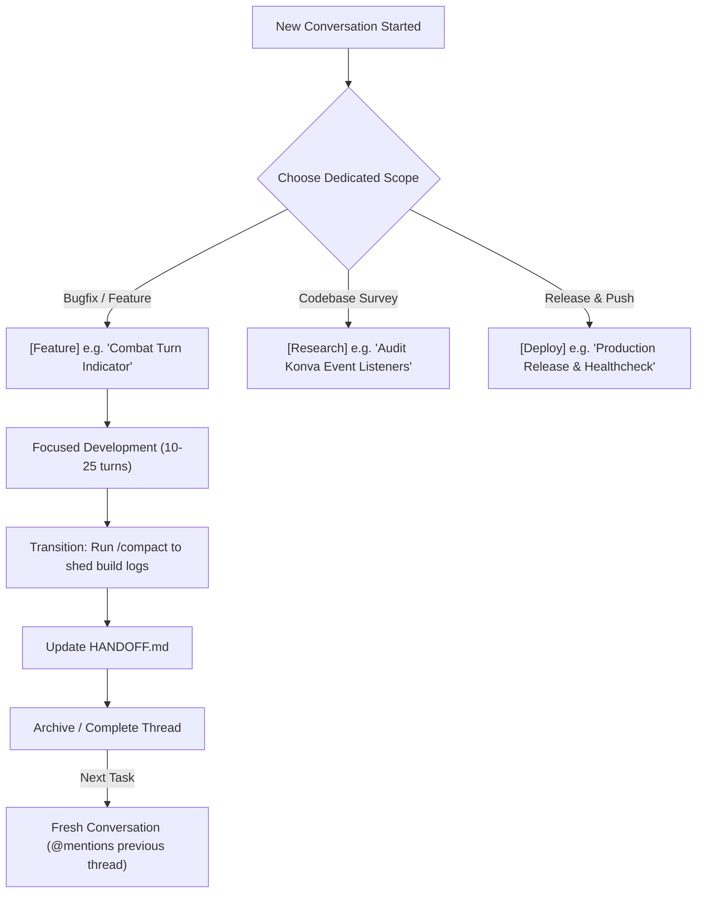

# Master Plan: Reorganizing Conversations & Subagents in MistWalker 3.0

## Executive Summary
Now that the project has transitioned to a streamlined single-target Production model (`v1-stable`), this plan establishes an operational framework to keep your chat sessions, background tasks, and subagents organized, high-performance, and clutter-free.

---

## 1. The "Task Lifecycle" Conversation Architecture

Instead of having endless, sprawling chat sessions that accumulate 50+ turns of tool output and mixed goals, organize conversations by **Scope and Lifecycle**:

### Conversation Thread Categories
1. **`[Feature/Fix]` Sessions**: Focused strictly on a single user story or bug (e.g., `fix: token elevation drop shadow`). When the feature is complete and verified, close the thread.
2. **`[Modularization]` Sessions**: Dedicated to extracting a specific component or hook from `App.tsx` or `LeftSidebar.tsx` with compilation gates.
3. **`[Deploy]` Sessions**: Dedicated to running `/stable-deploy-patch`, monitoring Render production deploys, and running smoke tests.

### Operational Conversation Rules
- **The 25-Turn Compaction Threshold**: If a conversation goes beyond 25 turns, run `/compact`. This keeps the token context lean and response latency fast.
- **Anchor Context with `@` Mentions**: When continuing work from a prior thread, start a fresh conversation and type `@conversation` to reference the previous session's summary instead of keeping the old thread alive.
- **Maintain [HANDOFF.md](file:///g:/Scott/dnd/MistWalker/Mistwalker%203.0/HANDOFF.md)**: Use `HANDOFF.md` as the persistent ledger of what was completed and what comes next.

---

## 2. Subagent Roles & Workspace Isolation Strategy

Subagents should never run as uncoordinated parallel workers in your live working directory. Organize them into three distinct tiers:

| Subagent Tier | Role Name | Workspace Mode | Permissions & Capabilities | When to Use |
| :--- | :--- | :--- | :--- | :--- |
| **Tier 1: Codebase Explorer** | `research` | `inherit` (read-only) | Read files, grep search, web lookup. No terminal write or file edit. | Finding symbols, auditing call sites, reading component interfaces without dumping hundreds of lines into main chat. |
| **Tier 2: Refactoring Sandbox** | `refactor-sandbox` | `branch` (isolated Git worktree) | Edit files, run build commands in an isolated branch. | Testing a large refactor or complex component extraction without risking your active workspace. |
| **Tier 3: Security Specialist** | `firestore-rules-author` | `inherit` | Cloud Firestore security rules specialist. | Any review or modification of `firestore.rules`. |

---

## 3. Persistent State Anchoring (`HANDOFF.md`)

Update [HANDOFF.md](file:///g:/Scott/dnd/MistWalker/Mistwalker%203.0/HANDOFF.md) to serve as the global cross-conversation anchor. Every time an agent finishes a major milestone, it updates `HANDOFF.md`:
- Current active branch (`v1-stable`).
- Recent modularizations and files created.
- Pending backlog items.
- Live deployment status.

---

## 4. Execution Steps to Implement This Organization

1. **Step 1: Overhaul [HANDOFF.md](file:///g:/Scott/dnd/MistWalker/Mistwalker%203.0/HANDOFF.md)**:
   - Bring `HANDOFF.md` up to date with the latest Single-Domain Production architecture, recent component extractions (`useTacticalGrid`, `GifImage`, `DiceFlyoutPanel`, `defaultTokens`), and upcoming roadmap items.
2. **Step 2: Commit Working Directory Cleanly**:
   - Commit all verified modularization files (`.agents/`, `docs/`, `src/hooks/`, `src/components/canvas/`, etc.) to `v1-stable`.
3. **Step 3: Define Custom Subagent Presets**:
   - Establish `.agents/rules/subagent-protocols.md` guidelines for naming conversation threads and launching isolated `branch` subagents.
