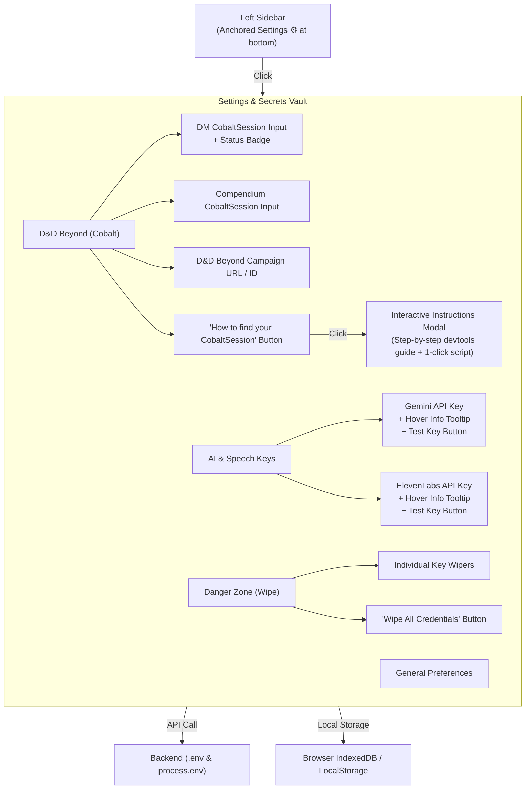

# DM Settings & Secrets Vault: Recommendations & Architecture Plan

## Executive Review & Assessment

Your proposed plan to add a dedicated **Settings** option to the bottom of the sidebar with D&D Beyond **Cobalt** synchronization, an interactive **How-To instructions popup**, blocks for all **sensitive API secrets**, **hover explanations**, and **wipe options** is an outstanding and necessary addition to MistWalker.

Currently, API keys and D&D Beyond tokens are split across different modals (`ApiKeyModal.tsx` in the AI menu and `DdbSyncModal.tsx` in the Compendium). Unifying all configuration into a single, cohesive **Settings & Secrets Vault** at the bottom of the sidebar will drastically improve DM workflow, eliminate confusion, and ensure private credentials are safe and easy to manage.

---

## 1. Recommendations & Workflow Enhancements

Here are our top architectural and UX recommendations to make this feature as smooth, secure, and intuitive as possible:

### Recommendation 1: Unified "Settings & Secrets Vault" Modal
Instead of creating another isolated dialog, create a unified `SettingsModal.tsx` accessible via a gear icon (⚙️) anchored at the bottom of the Left Sidebar.
- Organize it with clean vertical or horizontal tabs:
  1. **D&D Beyond (Cobalt)**: DM CobaltSession, Player/Compendium CobaltSession, Campaign URL/ID.
  2. **AI & Speech Services**: Gemini API Key, ElevenLabs API Key.
  3. **Connection Status & Diagnostic**: Real-time ping test for each configured service.
  4. **Danger Zone**: Granular wipe controls per service and a global "Wipe All Credentials" action.
- Existing buttons (like "API Key" in the AI menu or "Settings" in the DDB menu) can simply deep-link into the respective tab in this new Settings modal.

### Recommendation 2: The "Room for a Few Cobalt Details" Architecture
D&D Beyond provides and relies on a few distinct pieces of information. We recommend structuring the Cobalt section to support:
1. **Dungeon Master CobaltSession** *(Primary for write-back)*:
   - Allows MistWalker's combat tracker to automatically update player HP, conditions, and spell slots on their D&D Beyond character sheets in real time without prompting players for approval.
2. **Player / Compendium CobaltSession** *(Optional second session)*:
   - Used for scraping licensed D&D Beyond compendium books (Monster Manual, Volo's, etc.) and pulling official monster tokens if the DM uses a separate account or player token.
3. **Active D&D Beyond Campaign ID or URL**:
   - An input field where the DM can paste their campaign link (e.g., `https://www.dndbeyond.com/campaigns/1234567`).
   - Automatically extracts the campaign ID, displays connected character rosters, and links MistWalker to the live game log dice roller daemon.
4. **Auto-Detected Account Verification Badge**:
   - As soon as a valid Cobalt token is pasted, the backend validates it against D&D Beyond and displays:
     `Connected as: [Username] • 14 Books Owned • 6 Characters in Campaign` with a green status light.

### Recommendation 3: Interactive Visual "How-To" Popup
Beside the Cobalt inputs, place a prominent **"How to find this?"** button with a book/info icon (`HelpCircle` or `ExternalLink`). Clicking it opens a focused helper popup:
- **Visual Step-by-Step Guide**:
  1. Open [dndbeyond.com](https://www.dndbeyond.com) and log into your account.
  2. Press `F12` (or Right-Click anywhere and select **Inspect**) to open Developer Tools.
  3. Navigate to the **Application** tab (Chrome/Edge/Brave) or **Storage** tab (Firefox).
  4. Under the left menu, expand **Cookies** and select `https://www.dndbeyond.com`.
  5. Search for the cookie named `CobaltSession`.
  6. Double-click its **Value**, copy the entire string, and paste it into MistWalker.
- **1-Click Bookmarklet / Console Code**:
  - Provide a one-click "Copy Code Snippet" button:
    ```javascript
    copy(document.cookie.match(/CobaltSession=([^;]+)/)?.[1] || '');
    ```
    DMs can paste this into their browser console while on D&D Beyond to instantly copy their Cobalt token to their clipboard without searching through cookies manually.

### Recommendation 4: Hover Explanation Badges for Every Secret
For each secret block (Gemini, ElevenLabs, Cobalt), include:
- An **Info / Help Hover Icon** (`Info` or `HelpCircle`) that displays an informative tooltip popover explaining:
  - **What it does**: e.g., *"Powers the AI Dungeon Master, DM Assistant chatbot, automated battlemap generation, and room briefings."*
  - **Where it is stored**: *"Stored securely in local environment variables (.env) and client IndexedDB. Never shared."*
  - **Cost / Free Tier**: e.g., *"Free with rate limits from Google AI Studio. Direct link provided."*
  - **Where to get it**: A 1-click external link directly to the provider's key management portal (e.g. Google AI Studio, ElevenLabs dashboard).
- A **"Test Connection" button**:
  - Allows the DM to verify that their key is valid, active, and has remaining quota before starting their session.

### Recommendation 5: Granular vs. Nuclear Wipe Controls
Provide two levels of data clearing:
1. **Granular Wipe (Per Block)**:
   - A trash can icon (`Trash2`) next to each individual input (e.g., "Wipe DM Cobalt", "Wipe Gemini Key").
   - Clears the specific key from the server `.env`, resets backend memory, and removes it from client storage.
2. **Global Wipe (Nuclear Button)**:
   - A red button in a dedicated "Danger Zone" section: *"Wipe All Stored Secrets & Credentials"*.
   - Requires a confirmation prompt to prevent accidental clicks.
   - Clears all API keys, Cobalt sessions, and cached auth credentials across server `.env` and browser localStorage in a single action.

---

## 2. Component Architecture & UI Flow



---

## 3. Detailed Specification of Secret Blocks

| Secret / Field | Purpose | Hover Tooltip Summary | Storage & Security |
| :--- | :--- | :--- | :--- |
| **DM CobaltSession** | Live two-way sync with player D&D Beyond character sheets (HP, spell slots, conditions). | "Grants MistWalker permission to sync damage, heals, and conditions directly to your players' D&D Beyond sheets without manual prompts." | Stored in `.env` (`DND_BEYOND_DM_COBALT_SESSION`). Masked on display (`eyJh...89f`). |
| **Player / Compendium CobaltSession** | Scrapes official licensed monster statblocks, high-res circular tokens, and compendium lore. | "Allows MistWalker to access your purchased D&D Beyond books to import official bestiary monsters and token artwork." | Stored in `.env` (`DND_BEYOND_COBALT_SESSION`). Masked on display. |
| **D&D Beyond Campaign ID** | Links the active VTT session to a specific D&D Beyond campaign group. | "Automatically syncs characters in this campaign and connects to the live 3D dice roll stream." | Stored in `.env` / campaign settings. |
| **Google Gemini API Key** | Powers AI Dungeon Master, DM chatbot, procedural room descriptions, and map generation. | "Required for all AI features. Generates room lore, NPC dialog, statblocks, and map layouts. Free tier available at Google AI Studio." | Stored in `.env` (`GEMINI_API_KEY`). Masked on display. |
| **ElevenLabs API Key** | Powers studio-quality cinematic voice acting and ambient room narration. | "Generates ultra-realistic voice narration for room briefings and NPC speech. Optional." | Stored in `.env` (`ELEVENLABS_API_KEY`). Masked on display. |

---

## 4. Proposed Layout on Left Sidebar

Currently, the bottom section of `LeftSidebar.tsx` contains:
- `HelpCircle` ("HELP" button)
- `Bug` ("Report Bug" button)
- `FileText` ("Bug Manager & DM Notes")
- Pan & Select tool buttons (when a map is loaded)
- Zoom In / Zoom Out controls

### Suggested Placement:
Anchor the new **Settings (⚙️)** button directly alongside or below the Help button:
```
+-------------+
|   [AI DM]   |
|   -------   |
|   [HELP]    |
| [SETTINGS]  | <--- ⚙️ New Settings & Secrets Vault Button
|   [BUG 🐞]  |
|   -------   |
|  [PAN/SEL]  |
|   [+ / -]   |
+-------------+
```
This keeps all global app management (Help, Settings, Bug Reports) cleanly grouped together in the lower utility cluster of the sidebar.

---

## 5. Next Steps for Implementation

If you approve this plan, we can implement it in straightforward, non-breaking steps:
1. **Backend Endpoints**: Add `/api/settings/wipe-all` and verify `/api/ddb/set-token`, `/api/ai/set-key`, and wipe routes.
2. **Settings Modal (`SettingsModal.tsx`)**: Build the unified modal containing the Cobalt section, API keys, hover tooltips, and wipe buttons.
3. **How-To Guide Modal (`CobaltInstructionsModal.tsx`)**: Build the visual step-by-step devtools guide popup with the one-click copy script.
4. **Sidebar Integration (`LeftSidebar.tsx`)**: Add the ⚙️ Settings button to the sidebar bottom cluster.
5. **Testing & Deployment**: Run `npm run build`, commit, push to GitHub, and deploy live to Render.
