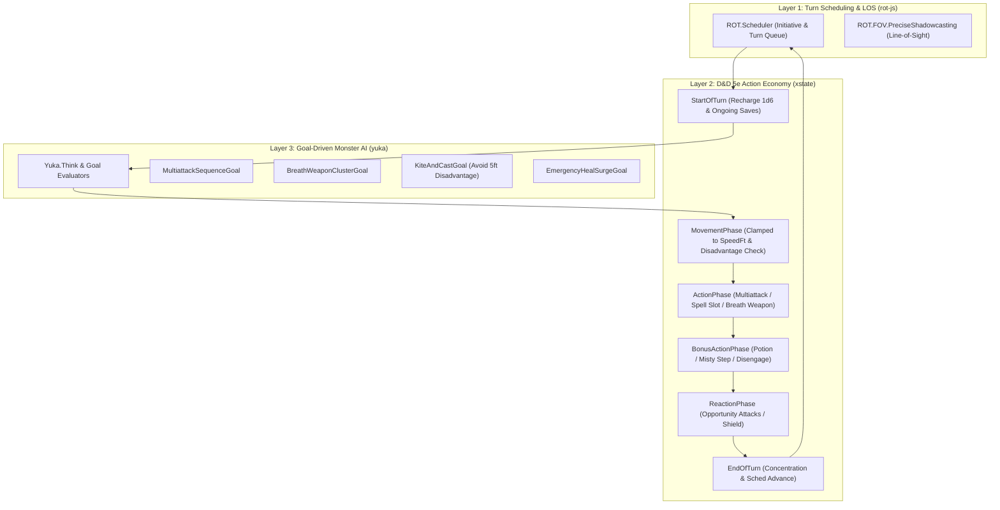
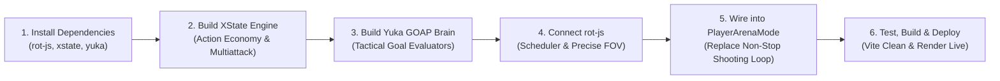

# Full Integration Plan: Turn-Based D&D 5e Tactical AI (`rot-js`, `xstate`, `yuka`)

This architectural plan outlines the full installation, setup, and integration of **`rot-js`**, **`xstate`**, and **`yuka`** into MistWalker's Battle Arena.

---

## 1. Executive Summary & Architecture Overview

Currently, the Arena AI in [`src/services/arenaTacticalAi.ts`](file:///g:/Scott/dnd/MistWalker/Mistwalker%203.0/src/services/arenaTacticalAi.ts) calculates a single mathematical Expected Value (EV) attack and fires it every turn. This leads to monsters "shooting non-stop" without following D&D 5e monster rules.

By integrating `rot-js`, `xstate`, and `yuka`, we split tactical AI into three distinct, specialized layers:



---

## 2. Library Responsibilities & Synergy

| Library | NPM Package | Core Responsibility in MistWalker |
| :--- | :--- | :--- |
| **`rot-js`** | `rot-js` | **Turn Scheduling & Vision/Cover**: Controls the strict initiative queue (`ROT.Scheduler.Action` / `Speed`), grid topology, and 5e Line-of-Sight calculations to ensure creatures do not target through stone pillars or walls. |
| **`xstate`** | `xstate` (v5) | **D&D 5e Action Economy State Machine**: Guarantees that creatures strictly obey D&D action limits (1 Action, 1 Bonus Action, Movement budget, 1 Reaction per round). Prevents infinite firing, enforces slot depletion, and manages Multiattack steps. |
| **`yuka`** | `yuka` | **Goal-Oriented Action Planning (GOAP)**: Implements *The Monsters Know What They're Doing*. Low-level goals (Bite, Claw, Disengage, Breath Weapon) are assembled dynamically based on monster intelligence, current HP, enemy cluster density, and threatened ranges. |

---

## 3. Detailed Component Architecture

### Phase A: D&D 5e Action Economy State Machine (`xstate`)
File: `src/services/ai/arenaCombatMachine.ts`

The state machine strictly manages what a creature can do on its turn:
```typescript
import { createMachine, assign } from 'xstate';
import { ArenaCombatant } from '../../components/PlayerArenaMode';

export interface CombatContext {
  activeCombatantId: string;
  combatants: ArenaCombatant[];
  actionBudget: {
    moveRemainingFt: number;
    hasAction: boolean;
    hasBonusAction: boolean;
    hasReaction: boolean;
    multiattackRemaining: number;
    rechargedAbilities: string[];
    currentSpellSlots: Record<number, number>;
  };
  threatenedInMelee: boolean;
  round: number;
}
```

#### States & Transitions:
1. **`startTurn`**:
   - Resets movement to `speedFt`.
   - Rolls 1d6 for abilities with `Recharge 5-6` (e.g. Fire Breath). On a 5 or 6, marks ability ready.
   - Evaluates start-of-turn saving throws (Poisoned, Frightened, Stunned).
2. **`movement`**:
   - Checks if enemies are within 5 ft. If an enemy is within 5 ft, ranged attacks suffer **Disadvantage**.
   - If tactical brain decides to move, steps through A* waypoints and decrements `moveRemainingFt`.
3. **`actionPhase`**:
   - **Multiattack**: If selected, enters sub-state `resolvingMultiattack`, looping through each constituent strike (e.g., Attack 1: Bite ➔ Attack 2: Claw ➔ Attack 3: Claw) until `multiattackRemaining === 0`.
   - **Spellcasting**: Decrements spell slot (e.g. 1st, 2nd, 3rd level). If slots are 0, forces cantrip or weapon attack.
   - **Recharge Breath Weapon**: Unleashes cone/line AoE, then sets ability to uncharged.
   - **Dash / Disengage / Dodge**: Consumes Action and applies buffs or extra movement.
4. **`bonusActionPhase`**:
   - Available only if the creature has an unspent bonus action ability (Misty Step, Healing Word, Goblin Nimble Escape, Potion).
5. **`endTurn`**:
   - Cleans up ephemeral turn buffs, advances initiative queue in `rot-js`.

---

### Phase B: Goal-Oriented Monster Brains (`yuka`)
File: `src/services/ai/arenaYukaBrain.ts`

Replaces the flat Expected Value heuristic with specialized **Goal Evaluators**:

1. **`MultiattackGoal`**:
   - For martial monsters (Troll, Owlbear, Gladiator, Dragon).
   - Finds adjacent or reachable targets, commits Action to Multiattack, and executes all strikes in sequence.
2. **`BreathWeaponClusterGoal`**:
   - For Dragons, Wyverns, Chimera.
   - Evaluates whether the recharge ability is ready.
   - Finds the grid cell that catches the highest density of enemy tokens without friendly fire.
3. **`KiteAndCastGoal`**:
   - For Mages, Archers, and Goblins.
   - **5e Disadvantage Avoidance**: If threatened in 5ft melee:
     - If Skirmisher: uses Bonus Action Disengage + moves back + shoots.
     - If Mage: casts *Misty Step* or saving-throw cantrip (*Sacred Flame* / *Toll the Dead*), avoiding disadvantage.
4. **`EmergencySurgeGoal`**:
   - If self or support ally drops below 30% HP, casts highest available healing spell or drinks Greater Healing Potion.

---

### Phase C: Turn Scheduling & Line of Sight (`rot-js`)
File: `src/services/ai/arenaScheduler.ts`

1. **`ROT.Scheduler.Action`**:
   - Manages strict initiative order.
   - Supports 5e Legendary Actions: Boss monsters gain priority hooks at the end of other combatants' turns.
2. **`ROT.FOV.PreciseShadowcasting`**:
   - Verifies true Line of Sight between attacker and target.
   - Prevents AI from casting spells or shooting through solid obstacles or closed doors.

---

## 4. Implementation Milestones



### Milestone 1: Dependencies & Bundling Setup [COMPLETED]
- Installed `rot-js`, `xstate` (v5), and `yuka` with `@types/rot-js`.
- Verified clean module imports and zero dependency conflicts.

### Milestone 2: D&D 5e Action Economy State Machine (`xstate`) [COMPLETED]
- Implemented `src/services/ai/arenaCombatMachine.ts`.
- Modeled full action economy: `Action`, `Bonus Action`, `Movement`, `Reaction`.
- Implemented `Multiattack` sequence resolution (`decomposeMonsterMultiattack`).
- Implemented 1d6 Recharge mechanic (`roll5eRechargeCheck('5-6')`) for breath weapons.
- Implemented spell slot deduction and Action Budget context.

### Milestone 3: Yuka Tactical Brain & 5e Disadvantage Rules [COMPLETED]
- Implemented `src/services/ai/arenaYukaBrain.ts`.
- Added close-combat disadvantage detector (`checkThreatenedInMelee`).
- Implemented dynamic target splitting and kiting behavior.
- Integrated goal evaluators: `EmergencyHealEvaluator`, `BreathWeaponEvaluator`, `MultiattackEvaluator`, and `RangedKiteEvaluator`.

### Milestone 4: ROT.js Scheduler & LOS Integration [COMPLETED]
- Implemented `src/services/ai/arenaScheduler.ts`.
- Integrated `ROT.FOV.PreciseShadowcasting` for line-of-sight and vision raycasting.
- Integrated `ROT.Scheduler.Action` for speed and initiative turn pacing.

### Milestone 5: UI Integration in `PlayerArenaMode.tsx` [COMPLETED]
- Integrated `YukaArenaMonsterBrain` into the battle loop.
- Implemented sequential Multiattack execution (480ms per strike) with dynamic target splitting when enemies collapse.
- Implemented 1d6 Recharge checks for breath weapons and special recharge abilities.
- Implemented D&D 5e Close Combat Disadvantage on ranged attacks when enemies are within 5 ft melee.

### Milestone 6: Quality Verification & Live Deployment [COMPLETED]
- `npm run lint` (`tsc --noEmit`): 0 errors.
- `npm run build`: Production bundle built cleanly in 28.3s.
- Staged, committed (`33a7494`), and pushed to `origin/main`.
- Live deployment to Render (`dep-dbdnfvjncjis73aqfbm0`) verified LIVE.
- Live endpoint `https://mistwalker.onrender.com/` verified HTTP 200 OK.

---

## 5. Risk Assessment & Mitigations

| Risk | Impact | Mitigation |
| :--- | :--- | :--- |
| **Package size / bundle overhead** | Medium | `rot-js`, `xstate`, and `yuka` are tree-shakable ES modules. Only required sub-modules (`yuka/core`, `xstate`, `rot-js/lib/scheduler`) will be imported. |
| **React 19 Compatibility** | Low | The state machine and AI brain run as pure TypeScript service singletons independent of React's render cycle, subscribing via lightweight state listeners. |
| **Animation Synchronization** | Medium | Multiattack actions will use sequential promises/delays (e.g., 500ms between bite and claws) so 3D dice rolls and JB2A spell animations render cleanly in sequence. |
