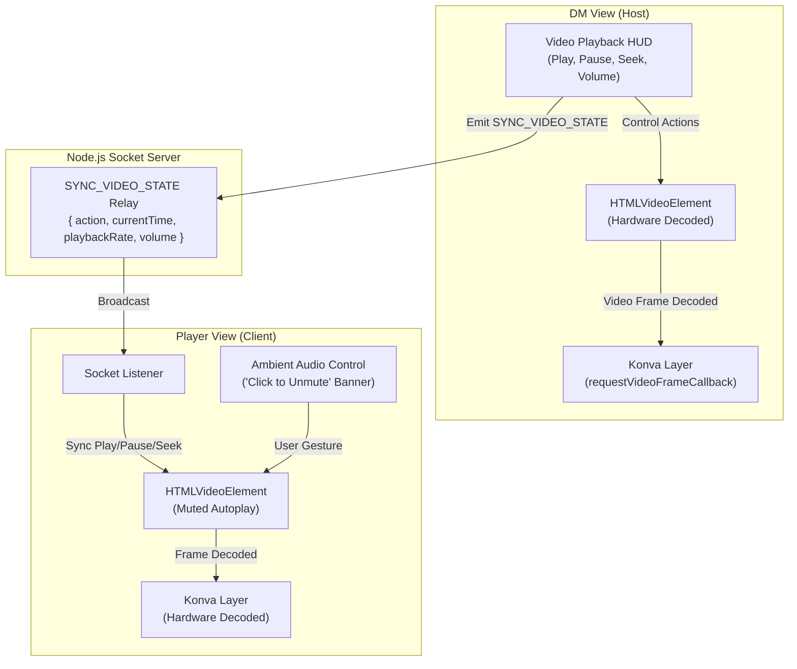
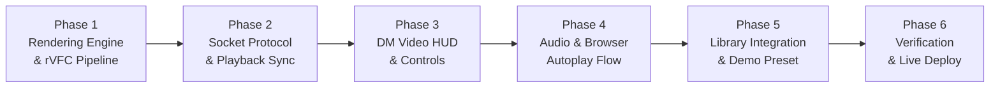

# Methodical Implementation Plan: Video Battlemaps for MistWalker

## Executive Summary
MistWalker currently includes early prototypes for video rendering via HTML5 `<video>` elements drawn onto a Konva canvas layer. However, video maps are not yet a complete, first-class feature: there are no DM playback controls, no audio/volume management, no real-time playback synchronization between DM and Player views, naive 60–144Hz render loops that cause high GPU/battery drain, and no bundled video map presets.

This plan details the full end-to-end design to upgrade Video Battlemaps into a smooth, production-grade feature with hardware-accelerated rendering, DM playback HUD, ambient audio controls, and seamless real-time player synchronization.

---

## 1. Current State vs. Target State Analysis

| Feature Area | Current Prototype State | Target Production State |
| :--- | :--- | :--- |
| **Rendering Loop** | Continuous `requestAnimationFrame` invoking `batchDraw()` every tick (60–144Hz) regardless of video state or frame rate. | Hardware-synced `HTMLVideoElement.requestVideoFrameCallback()` with fallback; pauses entirely when video is paused or hidden. |
| **DM Playback Controls** | None. Videos auto-loop silently with zero controls. | Floating DM Playback Bar: Play/Pause, Time Scrubber, Playback Speed (0.5x–2.0x), Loop Toggle, Mute & Volume. |
| **Real-Time Sync** | `SYNC_IMAGE` only sends the video URL. Player View plays independently; playback time & pause states drift. | Bidirectional `SYNC_VIDEO_STATE` socket event syncing play, pause, seek timestamps, and volume with drift correction. |
| **Audio & Ambiance** | Videos are hardcoded to `muted = true` everywhere. Ambient sound in maps is completely lost. | Integrated ambient audio pipeline: DM volume slider, Player View "Click to Unmute" compliance with browser autoplay policies. |
| **Scene Management** | Video URLs work in Campaign Builder, but file inputs and scene metadata lack clear video indicators. | Video badges (`MP4` / `WEBM`), video duration/dimension badges in library, and explicit "Import Video Battlemap" option. |
| **Demo Assets** | All 6 default campaign maps are static images. | Bundled, lightweight animated battlemap preset (e.g. animated campfire / river cavern) ready for instant one-click testing. |

---

## 2. Architecture & Data Flow



---

## 3. Core Pillars of Implementation

### Pillar 1: High-Performance GPU/Canvas Rendering Pipeline
Currently, `requestAnimationFrame` continuously triggers `batchDraw()` on the Konva layer at display refresh rate (often 120Hz or 144Hz), even though video maps are recorded at 24fps or 30fps. This wastes GPU cycles and causes laptop thermal throttling.

1. **`requestVideoFrameCallback` (rVFC)**:
   - Modern browsers (Chrome, Edge, Safari 15.4+, Firefox 125+) support `video.requestVideoFrameCallback()`.
   - Re-draws the Konva layer **only when the hardware decoder delivers a new frame** (exactly 24 or 30 times a second), slashing GPU usage by up to 70%.
   - Graceful fallback to throttled `requestAnimationFrame` (capped at 30fps) for older browsers.
2. **Pause-Aware Idle State**:
   - When the video is paused or the tab is hidden (`document.visibilityState === 'hidden'`), the render loop halts completely. Zero frames drawn while stationary.
3. **Dimension & Transform Stability**:
   - Read `videoWidth` and `videoHeight` from `loadedmetadata`.
   - Lock aspect ratio and snap dimensions into grid calculations to ensure walls, doors, and fog of war remain perfectly aligned.

---

### Pillar 2: DM Video Playback HUD
A sleek, collapsible floating toolbar docked at the bottom of the DM screen whenever an active scene contains a video map:

```
+-----------------------------------------------------------------------------------------+
| [▶ / ⏸]  [⏮ -5s]  [00:14 / 00:45] ═════════●══════════  [1.0x ▾]  [🔁 Loop]  [🔊 80%]  [⚡ Force Sync] |
+-----------------------------------------------------------------------------------------+
```

1. **Play / Pause**: Hotkey `Alt+P` or click. Instantly halts/resumes animation and sends socket sync.
2. **Scrubber Timeline**: Allows scrubbing through animated sequences (e.g., dynamic maps with rising water, collapsing walls, day-to-night transitions).
3. **Speed Selector**: Preset options `0.5x` (slow ambient motion), `0.75x`, `1.0x` (normal), `1.5x`, `2.0x`.
4. **Loop Toggle**: On by default for looping battlemaps; can be toggled off for cutscenes or one-shot animated spell maps.
5. **Volume & Ambient Audio Slider**: Controls the map's native audio stream (waterfalls, wind, crackling fire, chanting).

---

### Pillar 3: Real-Time Synchronization Protocol
To prevent drift between the DM's monitor and the player projector/screen:

#### Socket Events:
```typescript
interface VideoSyncPayload {
  action: 'play' | 'pause' | 'seek' | 'rate' | 'volume';
  currentTime: number;
  playbackRate: number;
  isPaused: boolean;
  timestamp: number; // Server epoch for latency calculation
}
```

1. **Drift Compensation**:
   - When Player View receives `SYNC_VIDEO_STATE`, it checks `Math.abs(playerVideo.currentTime - targetTime)`.
   - If drift is small (`< 0.4s`): Slightly adjusts playback speed (e.g. `1.03x` or `0.97x`) for 1 second to smoothly align without audio pitch glitch or visual hitching.
   - If drift is large (`> 1.0s`): Hard-seeks `playerVideo.currentTime = targetTime`.
2. **Initial State Catch-Up**:
   - When Player View opens or reloads (`REQUEST_INITIAL_STATE`), the DM broadcast includes `videoCurrentTime` and `videoIsPaused` so the player immediately catches up.

---

### Pillar 4: Ambient Audio & Browser Autoplay Compliance
Browsers enforce strict Autoplay Policies: media with sound cannot autoplay without user interaction.

1. **Muted by Default**: Both DM and Player views initialize the `<video>` with `muted = true` and `playsInline = true`.
2. **Player View Unmute Banner**:
   - If a video map contains an audio track, Player View displays a discreet top toast/banner:
     `"🔊 Animated Map has ambient audio. [Click to Unmute]"`
   - Once clicked, browser interaction requirements are met, and the map's ambient sounds play in sync with DM settings.
3. **Independent Player Volume Control**:
   - Players can adjust their local volume or mute without affecting the DM's screen.

---

### Pillar 5: Campaign Builder & Scene Library Integration
1. **Scene File Upload**:
   - File picker accepts: `image/*, video/mp4, video/webm, .m4v, .mov`.
   - Dedicated "Video Map" indicator badge in scene cards.
2. **Automatic Thumbnail Frame Seeking**:
   - Many video maps start with a 1-second fade from black.
   - The thumbnail generator (`createThumbnailDataUrl`) will seek to `1.5s` or `15%` of video duration to ensure scene cards show a clear, vibrant image instead of a black square.
3. **Persistent Cloud Storage Handling**:
   - Videos uploaded via `/api/upload` are streamed with byte-range headers (`Accept-Ranges: bytes`) for smooth seeking.
   - Support for external direct video URLs (e.g. CDN links, Google Drive direct stream, Dropbox, AWS S3) for large 4K files that exceed server upload limits.

---

### Pillar 6: Bundled Sample Animated Battlemap
To provide immediate out-of-the-box delight without requiring users to find an MP4 file:
- Bundle a high-quality, lightweight looping battlemap in `public/assets/` (e.g. `animated_cavern_stream.webm` or `animated_campfire.mp4`, 1080p, ~8–12MB).
- Include it in the Demo Campaign or as a preset scene in the Scene Library for instant one-click demonstration.

---

## 4. Phased Implementation Roadmap



### Phase 1: High-Efficiency Video Canvas Engine
- Replace continuous 60/144Hz `requestAnimationFrame` with `requestVideoFrameCallback` in `App.tsx` and `PlayerView.tsx`.
- Add pause-aware idle detection (0% canvas redraw when paused).
- Standardize natural dimension resolution on `loadedmetadata` to ensure grid and wall overlays never misalign.

### Phase 2: Real-Time Synchronization Protocol
- Implement `SYNC_VIDEO_STATE` socket event in `server.ts`.
- Broadcast play, pause, seek, playback rate, and volume across clients.
- Add drift detection and soft-sync compensation in `PlayerView.tsx`.

### Phase 3: DM Floating Playback Toolbar
- Build `VideoPlaybackHud.tsx` component docked cleanly on the DM board.
- Controls: Play/Pause, Scrubber bar with timestamp, Speed options, Mute/Volume slider, Force Sync button.
- Responsive hide/show toggle so it doesn't clutter the board when not in use.

### Phase 4: Ambient Audio & Autoplay Compliance
- Enable audio extraction from video maps.
- Implement discrete Player View "Unmute Ambiance" interaction prompt.
- Add audio level sync from DM with independent local player attenuation.

### Phase 5: Campaign Builder & Preset Asset
- Update `CampaignBuilderModal.tsx` scene card previews with video playback indicators.
- Improve thumbnail capture seeking to frame at 1.5s to avoid black thumbnail cards.
- Add 1 bundled looping video map preset for instant user testing.

### Phase 6: End-to-End Verification & Cloud Deployment
- Verify dual-window DM View + Player View synchronization.
- Test seeking, pausing, looping, and grid alignment.
- Verify production build (`npm run build`), Git push, and Render live cloud deploy.

---

## 5. Key Decisions & User Review Questions

> [!IMPORTANT]
> Before we start implementation, please review the following design decisions:

1. **DM HUD Placement**:
   - *Option A (Recommended)*: A sleek, semi-transparent floating control pill at the bottom-center of the DM screen that auto-collapses to a small icon when idle.
   - *Option B*: Integrated into the existing Left Sidebar under a dedicated "Video Controls" collapsible section.
2. **Audio Track Policy**:
   - *Option A (Recommended)*: Map ambient audio is synchronized from DM, but muted by default on Player View with a subtle "Click to Unmute" prompt (to respect browser autoplay policies and player noise preferences).
   - *Option B*: Map ambient audio is DM-only, with Player View audio left entirely silent unless manually toggled.
3. **Bundled Sample Scene**:
   - Should we add a dedicated sample animated scene (e.g. *The Sunken Shrine* or *Whispering River Cavern*) directly into the default Campaign selector?
